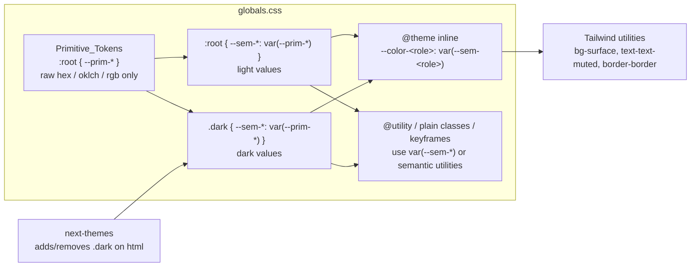

# Design Document: design-system-dark-mode

> **Palette refresh (owner decision).** The color palette, the Semantic_Token set (28 tokens) and the Primitive_Token set (51) in `frontend/DESIGN.md` sections 3.2 and 3.3 supersede every color value, token count, primitive name and contrast figure in this document (Data Models, Contrast table, ported-class color replacements). Non-color decisions (architecture, layer model, dark-mode runtime, fonts, motion, checks) still apply. The per-class mapping is in `IMPLEMENTATION_REPORT.md`, section "Approved Deviation: Palette Refresh". This document is not rewritten token by token; read `DESIGN.md` for current values.

## Overview

This design ports the Medicare design system from `frontend-react/` (Vite, Tailwind `^4.1.8`, installed 4.1.8) to `frontend/` (Next.js 16.4.6, React 19.3.0, Tailwind 4.3.3 through `@tailwindcss/turbopack`). It also adds dark mode with `next-themes`, a temporary `/design-check` route and `frontend/DESIGN.md`. The work is design-only (Requirement 1). Code wins over the root `DESIGN.md` (Requirement 2.4).

### Goals

| Goal | How the design meets it | Requirements |
| :--- | :--- | :--- |
| Light theme identical to legacy | Every legacy color reaches CSS through a Primitive_Token that holds the exact legacy value: hex for hex literals, the Tailwind v4 `oklch()` literal for palette utilities | 2, 3, 4, 10.6, 20 |
| One base font | Montserrat Alternates through `next/font/google`, weights 400/500/700/900; Satoshi dropped | 5, 6 |
| Dark mode without per-component overrides | Three layers: Primitive_Token → Semantic_Token (`:root` and `.dark`) → `@theme inline` mapping to `--color-<role>` | 9, 10, 11 |
| Accessible in both themes | Contrast pairs computed in this document; light legacy failures listed, not changed | 12, 13 |
| Reviewable | `/design-check` route, three commits, a Review_Stop after each | 14, 18 |
| No surprises | Lint, typecheck and build run before and after; Manual_Browser_Checks listed for the owner | 15, 19 |

### Inputs read

| Input | Finding used by this design |
| :--- | :--- |
| `frontend-react/src/index.css` | Full source of tokens, `@utility` classes, plain classes, 11 keyframes and 11 animation classes. `scrollbar-hide` applies zero palette utilities (it only sets `-ms-overflow-style`, `scrollbar-width` and `::-webkit-scrollbar { display: none }`). Code wins over the brief that listed `bg-white` for it. |
| `frontend-react/node_modules/tailwindcss/theme.css` 4.1.8 and `frontend/node_modules/tailwindcss/theme.css` 4.3.3 | Every palette value used by legacy `@utility` classes is identical in both versions (table in "Palette-derived primitives"). `--color-white: #fff`, `--color-black: #000`. |
| `frontend-react/node_modules/@tailwindcss/forms` 0.5.10 | With no `strategy`, the plugin adds base styles and a `.form-input` component class (`background-color: #fff`, `border-color: gray-500`, placeholder `gray-500`). The legacy `.form-input` element therefore combines the plugin class and the `@utility form-input`. Loading the plugin the same way reproduces this. |
| `frontend/package.json`, `next.config.ts`, `tsconfig.json`, `eslint.config.mjs` | No PostCSS config; CSS goes through the Turbopack rule `*.css → @tailwindcss/turbopack`. `reactCompiler: true` (left unchanged, Requirement 1.9). `eslint-plugin-react-hooks` 7.1.1 enables `react-hooks/set-state-in-effect`, `refs` and `purity` as errors, which shapes the client component designs below. |
| `frontend/src/app/page.tsx` | create-next-app page. It holds raw hex `#383838`, `#ccc` and `#1a1a1a` and uses `bg-foreground` / `text-background`. It is outside the Requirement 1.1 file list (see Open Questions, D2). |
| `next-themes@0.4.6` source (`dist/index.mjs`) | Behavior quoted in "Dark Mode Runtime". Peer range `react ^19` accepts React 19.3.0. |
| Git | Branch `migration/frontend-nextjs` is checked out. `frontend/` and `.kiro/` are untracked. `frontend-react/.gitignore` is staged. `frontend-react/dist/*` and `frontend-react/vite.config.js` have unstaged edits that belong to the owner. |

### Bundled Next.js 16.4.6 guides consulted (Requirement 1.5)

All paths are under `frontend/node_modules/next/dist/docs/01-app/`.

| Guide | Used for |
| :--- | :--- |
| `01-getting-started/13-fonts.md` and `03-api-reference/02-components/font.md` | `next/font/google` options `weight`, `style`, `subsets`, `display` (default `swap`), `preload` (default `true`), `adjustFontFallback`, `variable`; the "With Tailwind CSS" CSS-variable pattern on `<html>` |
| `03-api-reference/03-file-conventions/01-metadata/app-icons.md` | `favicon.ico` (top level of `app/` only), `icon.svg` (emits `sizes="any"`, `type="image/svg+xml"`), `apple-icon.tsx` generated with `ImageResponse` and exported `size` / `contentType` |
| `03-api-reference/04-functions/image-response.md` and `03-api-reference/03-file-conventions/01-metadata/opengraph-image.md` | `ImageResponse` from `next/og`; reading a local asset with `readFile(join(process.cwd(), …), 'base64')` into an `` data URI; 500 KB bundle limit; flexbox-only layout |
| `03-api-reference/04-functions/generate-metadata.md` | `robots: { index: false, follow: false }`; `themeColor`, `colorScheme` and `viewport` in `metadata` are deprecated, so this design uses none of them (Requirement 1.6) |
| `02-guides/preventing-flash-before-hydration.md` | Inline-script theme pattern, `suppressHydrationWarning` on `<html>`, the React dev warning for `<script>` rendered by components and the `type` switch that avoids it, and the Strict Mode remount that resets `<html>` attributes in development |
| `03-api-reference/03-file-conventions/layout.md` and `01-getting-started/03-layouts-and-pages.md` | Root layout must render `<html>` and `<body>`; `LayoutProps<'/'>` |
| `01-getting-started/11-css.md` | Tailwind v4 `@import 'tailwindcss'` setup and global CSS import from the root layout |

### Requirement traceability summary

| Requirement | Design section |
| :--- | :--- |
| 1 Scope | Architecture (file list), Commit Plan |
| 2 Light values | Data Models (primitives, light values), Ported Classes |
| 3 Port tokens/utilities/keyframes | Architecture (globals.css layout), Ported Classes |
| 4 Semantic tokens from hex | Data Models (inventory, primitives, semantic tokens) |
| 5, 6 Fonts and license | Fonts |
| 7 Logos and icons | Architecture (assets), Components (app icons) |
| 8 Dependencies | Architecture (dependencies) |
| 9 Dark mode strategy | Dark Mode Runtime |
| 10 Dual-value tokens | Data Models, Correctness Properties 4–6 |
| 11 Dark palette | Data Models (dark values and contrast table) |
| 12 Accessibility | Data Models (contrast table), Ported Classes (reduced motion), Components |
| 13 Theme_Toggle | Components and Interfaces: Theme_Toggle |
| 14 Design_Check_Route | Components and Interfaces: Design_Check_Route |
| 15 Build verification | Testing Strategy |
| 16 DESIGN.md | DESIGN.md plan |
| 17 Reporting | Data Models (ambiguous and unused lists), Open Questions |
| 18 Commits | Commit Plan and Review Stops |
| 19 Final report | Testing Strategy (manual checks), Open Questions |
| 20 Palette utilities in ported classes | Data Models (Requirement 20 mapping table) |
| 21 next-themes version and warnings | Dark Mode Runtime |

## Architecture

### Layer model



Naming rules:

| Layer | Prefix | Example | Rule |
| :--- | :--- | :--- | :--- |
| Primitive_Token | `--prim-` | `--prim-navy-700: #252a61;` | Only place raw hex is allowed (Requirement 10.7). Declared once on `:root`, shared by both themes. |
| Semantic_Token | `--sem-` | `--sem-brand: var(--prim-navy-700);` | Declared in `:root` and in `.dark`; value is always `var(--prim-*)` (Requirement 10.1). |
| Tailwind theme color | `--color-` | `--color-brand: var(--sem-brand);` | Declared in `@theme inline` so compiled utilities contain `var(--sem-brand)` and no literal (Requirement 10.3). |

The `--prim-` and `--sem-` prefixes keep the custom properties out of the Tailwind theme namespaces (`--text-*`, `--shadow-*`, `--color-*`), so names such as `--sem-text` or `--sem-shadow` cannot collide with Tailwind font-size or shadow variables.

`.dark` is a plain class selector, not `html.dark`. Its specificity (0,1,0) equals `:root`, and the `.dark` rule comes later in the file, so it wins on `<html class="dark">`.

### Target file layout

Every path below is inside `frontend/`. "C1", "C2" and "C3" name the commit that adds or changes the file (see Commit Plan).

| Path | Status | Commit | Allowed by |
| :--- | :--- | :--- | :--- |
| `src/app/globals.css` | modified | C1 (light), C2 (dark, a11y) | 1.1 Globals_Stylesheet |
| `src/app/layout.tsx` | modified | C1 (font, metadata), C2 (provider) | 1.1 Root_Layout |
| `src/assets/logo/medicare-logo-full-on-light.svg` | new, byte copy | C1 | 1.1, 7.1 |
| `src/assets/logo/medicare-logo-full-on-dark.svg` | new, byte copy | C1 | 1.1, 7.1 |
| `src/assets/logo/medicare-logo-icon-on-light.svg` | new, byte copy | C1 | 1.1, 7.1 |
| `src/assets/logo/medicare-logo-icon-on-dark.svg` | new, byte copy | C1 | 1.1, 7.1 |
| `src/app/favicon.ico` | unchanged (sha256 `bdbf6368…6523`) | — | 7.4 |
| `src/app/icon.svg` | new, byte copy of `medicare-logo-icon-on-light.svg` | C1 | 1.1, 7.4 |
| `src/app/apple-icon.tsx` | new, `ImageResponse` 180×180 PNG | C1 | 1.1, 7.4 |
| `src/components/theme/theme-mode.ts` | new, pure helpers | C2 | 1.1 Theme_Provider / Theme_Toggle |
| `src/components/theme/theme-provider.tsx` | new, client component | C2 | 1.1 Theme_Provider |
| `src/components/theme/theme-toggle.tsx` | new, client component | C2 | 1.1 Theme_Toggle |
| `src/app/design-check/**` | new route folder | C2 | 1.1, 14.1 |
| `package.json`, `package-lock.json` | modified | C1 (3 plugins), C2 (`next-themes`) | 1.1, 8.6 |
| `DESIGN.md` | new | C3 | 1.1, 16 |

Source logo hashes (sha256), which the copies must match (Requirement 7.2):

| Source in `src/assets/Medicare logo/solid/` | sha256 |
| :--- | :--- |
| `medicare-logo-full-on-light.svg` | `f66bd7205ae435f1bbac2e10ad3eca3a70e961b26d39b928bdf936da6cd8fc61` |
| `medicare-logo-full-on-dark.svg` | `e9d7f509c7006ecfaf2b508933dd83581f0e25230adc2f35987d2d1978243232` |
| `medicare-logo-icon-on-light.svg` | `d8ff46519c4ea4d3c904be6a7cbd113648303d77d50545d06ff681a8d4ddc1ce` |
| `medicare-logo-icon-on-dark.svg` | `21f5b154904eec03206172e4009b79be58f3e02f9d9659ce50dafef5e2ea3058` |

All four source files exist, so Requirement 7.3 has nothing to report. The icon SVG has a square `viewBox="0 0 375 374.999991"` and contains only paths and 15 `clipPath` elements (no `<text>`, `<image>` or `<style>`), so `ImageResponse` (Satori/Resvg) can render it.

Files left untouched and listed for the owner (Requirement 7.5): `src/app/favicon1.ico` (432,254 bytes), `src/app/favicon2.ico` (4,286 bytes, different hash from `favicon.ico`), `src/assets/Medicare logo/solid/medicare-logo-text-only-on-{light,dark}.svg`, `src/assets/Medicare logo/transparent/ medicare-logo-icon-tp-on-white.{png,svg}` (names start with a space), `src/assets/Medicare logo/medicare_logo_text_only_curve_light copy.png`.

Files never committed: `frontend/requirements.md` (stray spec copy), `frontend/.env.local` (ignored by `.env*`), the staged `frontend-react/.gitignore`, and every `frontend-react/` change.

### globals.css section order

The file is ordered so that cascade and Tailwind processing match the legacy file. Sections marked C2 are added in the dark-mode commit.

| # | Section | Content | Requirements |
| :--- | :--- | :--- | :--- |
| 1 | Imports and plugins | `@import "tailwindcss";` then `@plugin "@tailwindcss/forms";`, `@plugin "@tailwindcss/typography";`, `@plugin "@tailwindcss/aspect-ratio";` | 3.2, 3.12 (no Fontshare import) |
| 2 | Dark variant (C2) | `@custom-variant dark (&:where(.dark, .dark *));` | 9.8 |
| 3 | Primitive_Tokens | `:root { --prim-*: … }` light and (C2) dark primitives | 4.2, 10.7, 20.2 |
| 4 | Light Semantic_Tokens | `:root { color-scheme: light; --sem-*: var(--prim-*); }` (`color-scheme` added in C2) | 10.1, 12.5 |
| 5 | Dark Semantic_Tokens (C2) | `.dark { color-scheme: dark; --sem-*: var(--prim-*); }` | 10.1, 10.2, 11, 12.5 |
| 6 | Theme | `@theme { --breakpoint-xs: 320px; --shadow-custom: 0px 10px 20px rgba(0, 0, 0, 0.2); }` and `@theme inline { --font-sans; --font-montserrat; --color-<role>: var(--sem-<role>); … }` | 2.1, 3.1, 4.4, 5.2, 5.5, 10.3 |
| 7 | Base layer | `@layer base { border-color compat rule; html, body { font-family: var(--font-sans); } body { background-color: var(--sem-page); color: var(--sem-page-fg); } }` | 3.3, 3.11, 5.4 |
| 8 | Utilities layer | `@layer utilities { html, body { overflow-x: hidden; width: 100%; max-width: 100%; } }` (no `#root`) | 3.7, 3.12 |
| 9 | `@utility` classes | The 23 classes in legacy order, palette utilities replaced | 3.4, 20 |
| 10 | Plain classes, keyframes, animation classes | Legacy order, legacy selectors, unlayered; duplicate classes resolved per "Ported Classes" | 3.5, 3.6, 3.8, 3.10, 11.7 |
| 11 | Reduced motion (C2) | `@media (prefers-reduced-motion: reduce) { … }` as the last rule | 12.6 |

`--shadow-custom` keeps its literal `rgba(0, 0, 0, 0.2)`. It is a Legacy_Token, it contains no hex, and keeping the literal avoids depending on how Tailwind rewrites shadow colors into `var(--tw-shadow-color, …)`.

Abbreviated skeleton (the full token lists are in Data Models):

```css
@import "tailwindcss";

@plugin "@tailwindcss/forms";
@plugin "@tailwindcss/typography";
@plugin "@tailwindcss/aspect-ratio";

@custom-variant dark (&:where(.dark, .dark *)); /* C2 */

:root {
  /* Primitive_Tokens: the only raw color literals in the Target_App */
  --prim-white: #ffffff;
  --prim-navy-700: #252a61;
  --prim-tw-gray-200: oklch(92.8% 0.006 264.531);
  /* … */
}

:root {
  color-scheme: light; /* C2 */
  --sem-page: var(--prim-white);
  --sem-brand: var(--prim-navy-700);
  --sem-border-default: var(--prim-tw-gray-200);
  /* … */
}

.dark { /* C2 */
  color-scheme: dark;
  --sem-page: var(--prim-navy-d-950);
  --sem-brand: var(--prim-brand-d);
  --sem-border-default: var(--prim-navy-d-600);
  /* … same names as :root */
}

@theme {
  --breakpoint-xs: 320px;
  --shadow-custom: 0px 10px 20px rgba(0, 0, 0, 0.2);
}

@theme inline {
  --font-sans: var(--font-montserrat-alternates), ui-sans-serif, system-ui, -apple-system, "Segoe UI", Arial, sans-serif;
  --font-montserrat: var(--font-montserrat-alternates), sans-serif;
  --color-primary: var(--sem-primary);
  --color-secondary: var(--sem-secondary);
  --color-accent: var(--sem-accent);
  --color-page: var(--sem-page);
  --color-brand: var(--sem-brand);
  /* one line per Semantic_Token */
}

@layer base {
  *, ::after, ::before, ::backdrop, ::file-selector-button {
    border-color: var(--sem-border-default);
  }
  html, body { font-family: var(--font-sans); }
  body { background-color: var(--sem-page); color: var(--sem-page-fg); }
}

@layer utilities {
  html, body { overflow-x: hidden; width: 100%; max-width: 100%; }
}

@utility card {
  @apply bg-surface rounded-xl shadow-xs p-4 sm:p-6 border border-border-subtle;
}
/* … remaining @utility classes, plain classes, keyframes … */

@media (prefers-reduced-motion: reduce) { /* C2, see Ported Classes */ }
```

### Root_Layout changes

Commit C1 (no `next-themes`, so it builds on its own, Requirement 18.6):

```tsx
import type { Metadata } from "next";
import { Montserrat_Alternates } from "next/font/google";
import "./globals.css";

const montserratAlternates = Montserrat_Alternates({
  subsets: ["latin"],
  weight: ["400", "500", "700", "900"],
  style: ["normal"],
  display: "swap",
  variable: "--font-montserrat-alternates",
});

export const metadata: Metadata = {
  title: "Medicare",
};

export default function RootLayout({ children }: LayoutProps<"/">) {
  return (
    <html lang="en" className={`${montserratAlternates.variable} h-full`}>
      <body className="min-h-full flex flex-col">{children}</body>
    </html>
  );
}
```

Commit C2 adds `suppressHydrationWarning` on `<html>` only (Requirement 21.4) and wraps the body content:

```tsx
import { ThemeProvider } from "@/components/theme/theme-provider";
// …
<html lang="en" className={`${montserratAlternates.variable} h-full`} suppressHydrationWarning>
  <body className="min-h-full flex flex-col">
    <ThemeProvider>{children}</ThemeProvider>
  </body>
</html>
```

| Change | Reason |
| :--- | :--- |
| Geist and Geist_Mono removed | Requirement 5.5 |
| `antialiased` removed from `<html>` | The legacy app sets no font smoothing; keeping it would change light-theme text rendering (Requirement 2). `h-full` and `min-h-full flex flex-col` stay because the scaffold page depends on them and they set no color or font. |
| `title: "Medicare"` | Legacy `index.html` title. The create-next-app `description` placeholder is removed; the legacy app has none. |
| No `preload` or `adjustFontFallback` options | Defaults stay `true` (Requirement 5.8) |

### Dependencies

| Package | Section | Specifier | Expected lockfile version | Commit | Note |
| :--- | :--- | :--- | :--- | :--- | :--- |
| `@tailwindcss/forms` | devDependencies | `^0.5.10` (legacy specifier) | 0.5.11 | C1 | Peer `tailwindcss >=4.0.0-beta.1` |
| `@tailwindcss/typography` | devDependencies | `^0.5.16` (legacy specifier) | 0.5.20 | C1 | Peer `>=4.0.0` |
| `@tailwindcss/aspect-ratio` | devDependencies | `^0.4.2` (legacy specifier) | 0.4.2 | C1 | Peer `>=2.0.0`, so 4.3.3 satisfies it |
| `next-themes` | dependencies | `^0.4.6` | 0.4.6 | C2 | Peer `react ^19` |

Versions are from `npm view` at design time; the Implementer records the resolved versions from `package-lock.json` (Requirements 8.7, 21.1). Install commands: `npm install -D @tailwindcss/forms@^0.5.10 @tailwindcss/typography@^0.5.16 @tailwindcss/aspect-ratio@^0.4.2` and `npm install next-themes@^0.4.6`, with no `--force` or `--legacy-peer-deps` (Requirement 8.4). Using the legacy specifiers is a recommendation (Open Questions, D12).

`@tailwindcss/aspect-ratio` 0.4.2 is a v3-era plugin. It loaded through `@plugin` in the legacy v4.1.8 build. The C1 build output check (Testing Strategy) confirms that `aspect-w-16` generates CSS under 4.3.3 and Turbopack; if it does not, Requirement 8.4 reporting applies.

## Data Models

### Hex inventory method (Requirement 4.1)

Scope: `.js`, `.jsx`, `.ts`, `.tsx`, `.css`, `.html` under `frontend-react/src` (99 files). Pattern: `#` followed by exactly 8, 6, 4 or 3 hex digits, with no letter, digit or underscore after them; case-insensitive; 3- and 4-digit forms expanded to 6 and 8 digits. The design-time scan found 116 distinct values and 1,070 occurrences; 65 values occur in only one file. Counts include `src/index.css`, so `#252a61` is 187 here versus 184 in the requirements table. The Implementer re-runs the scan and reports its own numbers in the Final_Report. Role assignment uses the semantic role across all occurrences (for example all 66 `#4318ff` uses are on auth screens, so the role is `auth-primary` even though no single CSS property is used more than half the time).

### Primitive_Tokens: inventory hex (light values)

| Primitive | Value | Count / files | Inventory role | Tailwind v3 palette equivalent (Requirement 4.7) |
| :--- | :--- | :--- | :--- | :--- |
| `--prim-navy-700` | `#252a61` | 187 / 21 | brand, primary | — |
| `--prim-navy-600` | `#3b3b98` | 14 / 7 (13 `hover:bg-`) | brand-hover | — |
| `--prim-periwinkle-200` | `#b8c5fd` | 3 / 3 | secondary | — |
| `--prim-blush-200` | `#e8c3d5` | 3 / 3 | accent | — |
| `--prim-white` | `#ffffff` | 68 / 13 (39 `color`, 21 `background`) | on-brand, on-auth-primary (dominant, 57%); surface | white |
| `--prim-black` | `#000000` | 2 / 2 | page-fg, shadow, overlay | black |
| `--prim-ink-900` | `#0f172a` | 35 / 11 (26 `color`) | text, status `-fg` (light) | slate-900 |
| `--prim-ink-900-alt` | `#111827` | 3 / 2 | text (near-duplicate, Requirement 4.6; unreferenced) | gray-900 |
| `--prim-slate-600` | `#475569` | 11 / 5 (all `color`) | text-subtle | slate-600 |
| `--prim-slate-500` | `#64748b` | 43 / 10 (41 `color`) | text-muted | slate-500 |
| `--prim-slate-200` | `#e2e8f0` | 26 / 7 | skeleton-base | slate-200 |
| `--prim-slate-100` | `#f1f5f9` | 38 / 10 (22 `background`) | surface-muted | slate-100 |
| `--prim-slate-50` | `#f8fafc` | 22 / 8 (17 `background`) | surface-subtle | slate-50 |
| `--prim-slate-50-alt` | `#fafbfc` | 2 / 2 | surface-subtle (near-duplicate; unreferenced) | — |
| `--prim-mist-200` | `#e8edf5` | 26 / 11 (16 `border`) | border | — |
| `--prim-violet-600` | `#4318ff` | 66 / 4 | auth-primary | — |
| `--prim-violet-700` | `#3311db` | 4 / 2 (`hover:`) | auth-primary-hover | — |
| `--prim-emerald-500` | `#10b981` | 22 / 10 | success, chart-3 | emerald-500 |
| `--prim-amber-500` | `#f59e0b` | 9 / 4 | warning, chart-5 | amber-500 |
| `--prim-red-500` | `#ef4444` | 15 / 4 | danger | red-500 |
| `--prim-red-600` | `#dc2626` | 13 / 2 (11 in `pages/Doctor/EmergencyFolder.jsx`) | emergency | red-600 |
| `--prim-sky-500` | `#0ea5e9` | 12 / 6 | info, chart-4 | sky-500 |
| `--prim-indigo-500` | `#6366f1` | 67 / 11 | chart-1 (proposed) | indigo-500 |
| `--prim-purple-500` | `#8b5cf6` | 25 / 11 | chart-2 (proposed) | violet-500 |
| `--prim-orange-500` | `#f97316` | 7 / 4 | chart-6 (proposed) | orange-500 |
| `--prim-gradient-indigo` | `#667eea` | 2 / 2 | gradient-text-start (`.gradient-text`) | — |
| `--prim-gradient-plum` | `#764ba2` | 2 / 2 | gradient-text-end (`.gradient-text`) | — |
| `--prim-hero-navy` | `#1a1f4a` | 4 / 1 (`pages/Service2.jsx`) | hero-gradient-deep | — |
| `--prim-hero-navy-alt` | `#1a1f4d` | 1 / 1 (`pages/Home.jsx`) | hero-gradient-deep (near-duplicate; unreferenced) | — |

### Primitive_Tokens: palette-derived (Requirement 20.2)

These hold the Tailwind v4 `oklch()` literal, copied from `theme.css` (identical in 4.1.8 and 4.3.3), so the light computed value equals the legacy utility exactly. The sRGB column comes from an Oklab→sRGB conversion with clipping at design time; the Implementer records browser-computed values in the Final_Report.

| Primitive | Value | Approx. sRGB | Legacy source |
| :--- | :--- | :--- | :--- |
| `--prim-tw-gray-50` | `oklch(98.5% 0.002 247.839)` | 249, 250, 251 | `hover:bg-gray-50` |
| `--prim-tw-gray-100` | `oklch(96.7% 0.003 264.542)` | 243, 244, 246 | `border-gray-100`, `bg-gray-100` |
| `--prim-tw-gray-200` | `oklch(92.8% 0.006 264.531)` | 229, 231, 235 | compat rule, `hover:bg-gray-200` |
| `--prim-tw-gray-300` | `oklch(87.2% 0.01 258.338)` | 209, 213, 220 | `border-gray-300` |
| `--prim-tw-gray-500` | `oklch(55.1% 0.027 264.364)` | 106, 114, 130 | `@tailwindcss/forms` placeholder color |
| `--prim-tw-gray-600` | `oklch(44.6% 0.03 256.802)` | 74, 85, 101 | `text-gray-600` |
| `--prim-tw-gray-700` | `oklch(37.3% 0.034 259.733)` | 54, 65, 83 | `text-gray-700` |
| `--prim-tw-gray-900` | `oklch(21% 0.034 264.665)` | 16, 24, 40 | `text-gray-900` |
| `--prim-tw-blue-100` | `oklch(93.2% 0.032 255.585)` | 219, 234, 254 | `focus:ring-blue-100` |
| `--prim-tw-blue-300` | `oklch(80.9% 0.105 251.813)` | 142, 197, 255 | `focus:border-blue-300` |
| `--prim-tw-green-100` | `oklch(96.2% 0.044 156.743)` | 220, 252, 231 | `bg-green-100` |
| `--prim-tw-green-800` | `oklch(44.8% 0.119 151.328)` | 1, 102, 48 | `text-green-800` |
| `--prim-tw-yellow-100` | `oklch(97.3% 0.071 103.193)` | 254, 249, 194 | `bg-yellow-100` |
| `--prim-tw-yellow-800` | `oklch(47.6% 0.114 61.907)` | 137, 75, 0 | `text-yellow-800` |
| `--prim-tw-red-100` | `oklch(93.6% 0.032 17.717)` | 255, 226, 226 | `bg-red-100` |
| `--prim-tw-red-800` | `oklch(44.4% 0.177 26.899)` | 159, 7, 18 | `text-red-800` |
| `--prim-tw-red-50` | `oklch(97.1% 0.013 17.38)` | 254, 242, 242 | proposed `emergency-subtle` light (not legacy) |
| `--prim-tw-sky-100` | `oklch(95.1% 0.026 236.824)` | 223, 242, 254 | proposed `info-subtle` light (not legacy) |

`text-white` and `bg-white` reuse `--prim-white` and `text-black` reuses `--prim-black`, because `--color-white: #fff` and `--color-black: #000` are the same values (one primitive per value, Requirement 4.2).

Legacy rgb literals that become primitives (allowed: "hex or rgba literal"):

| Primitive | Value | Legacy source |
| :--- | :--- | :--- |
| `--prim-scroll-blue` | `rgb(147, 197, 253)` | `.custom-scrollbar` thumb start and `scrollbar-color` |
| `--prim-scroll-violet` | `rgb(196, 181, 253)` | `.custom-scrollbar` thumb end |
| `--prim-scroll-gray` | `rgb(243, 244, 246)` | `.custom-scrollbar` track |

### Primitive_Tokens: dark values (proposed, C2)

| Primitive | Value | HSL (h, s, l) | Used by (dark) |
| :--- | :--- | :--- | :--- |
| `--prim-navy-d-1000` | `#05061a` | 237°, 68%, 6% | overlay |
| `--prim-navy-d-950` | `#0b0e24` | 233°, 53%, 9% | page, on-brand, on-auth-primary, all status `-fg` |
| `--prim-navy-d-900` | `#0f1330` | 233°, 52%, 12% | surface-subtle, input-bg |
| `--prim-navy-d-850` | `#13173a` | 234°, 51%, 15% | surface, glass-surface, hero-gradient-deep |
| `--prim-navy-d-800` | `#1b2047` | 233°, 45%, 19% | surface-muted, skeleton-base, scrollbar-track |
| `--prim-navy-d-750` | `#1e2450` | 233°, 46%, 22% | surface-hover |
| `--prim-navy-d-700` | `#1f2654` | 232°, 46%, 23% | surface-control, border-subtle |
| `--prim-navy-d-650` | `#242b5b` | 232°, 43%, 25% (24.9) | surface-control-hover, skeleton-highlight |
| `--prim-navy-d-600` | `#2b3263` | — | border, border-default |
| `--prim-navy-d-500` | `#3a4378` | — | glass-border |
| `--prim-indigo-d-400` | `#6b74a8` | — | input-border |
| `--prim-indigo-d-300` | `#7f8ce0` | — | input-focus-ring |
| `--prim-indigo-d-250` | `#9aa8f2` | — | input-border-focus, gradient-text-start |
| `--prim-indigo-d-200` | `#a9b3f5` | — | focus-ring |
| `--prim-mist-d-50` | `#f2f3fa` | — | page-fg, text-heading |
| `--prim-mist-d-100` | `#e8eaf6` | — | text |
| `--prim-mist-d-200` | `#d4d8ef` | — | text-label |
| `--prim-mist-d-300` | `#c5cae6` | — | text-body |
| `--prim-mist-d-400` | `#b8bddd` | — | text-subtle |
| `--prim-mist-d-500` | `#a6acd0` | — | text-muted |
| `--prim-mist-d-600` | `#959cc4` | — | input-placeholder |
| `--prim-brand-d` | `#9ba3d4` | 232°, 40%, 72% | brand, primary |
| `--prim-brand-d-hover` | `#b3b9e0` | 232°, 42%, 79% | brand-hover |
| `--prim-periwinkle-d` | `#cfd6f4` | 229°, 63%, 88% | secondary |
| `--prim-blush-d` | `#f0dce6` | 330°, 40%, 90% | accent |
| `--prim-violet-d-400` | `#a091f0` | 250°, 76%, 76% | auth-primary |
| `--prim-violet-d-300` | `#b6abf3` | 249°, 75%, 81% | auth-primary-hover |
| `--prim-emerald-d` | `#34d399` | — | success, chart-3 (v3 emerald-400) |
| `--prim-emerald-d-subtle` | `#0d2a2c` | — | success-subtle |
| `--prim-emerald-d-text` | `#6ee7b7` | — | success-text (v3 emerald-300) |
| `--prim-amber-d` | `#fbbf24` | — | warning, chart-5 (v3 amber-400) |
| `--prim-amber-d-subtle` | `#2e2612` | — | warning-subtle |
| `--prim-amber-d-text` | `#fcd34d` | — | warning-text (v3 amber-300) |
| `--prim-red-d` | `#f87171` | — | danger (v3 red-400) |
| `--prim-red-d-subtle` | `#3a1620` | — | danger-subtle |
| `--prim-red-d-text` | `#fca5a5` | — | danger-text (v3 red-300) |
| `--prim-emergency-d` | `#ff5c5c` | — | emergency |
| `--prim-emergency-d-subtle` | `#46111c` | — | emergency-subtle |
| `--prim-sky-d` | `#38bdf8` | — | info, chart-4 (v3 sky-400) |
| `--prim-sky-d-subtle` | `#0c2540` | — | info-subtle |
| `--prim-indigo-d-chart` | `#a5b4fc` | — | chart-1 (v3 indigo-300) |
| `--prim-purple-d-chart` | `#c4b5fd` | — | chart-2 (v3 violet-300) |
| `--prim-orange-d-chart` | `#fb923c` | — | chart-6 (v3 orange-400) |
| `--prim-gradient-plum-d` | `#b996e0` | — | gradient-text-end |
| `--prim-scroll-d-thumb` | `#4f5a9a` | — | scrollbar-thumb |
| `--prim-scroll-d-thumb-end` | `#6a5aa6` | — | scrollbar-thumb-end |
| `--prim-scroll-d-hover` | `#6d78bd` | — | scrollbar-thumb-hover |
| `--prim-scroll-d-hover-end` | `#8a78c4` | — | scrollbar-thumb-hover-end |

Dark hex values that equal a Tailwind v3 palette hex are noted in the "Used by" column so DESIGN.md can record them (Requirement 4.7).

### Semantic_Tokens

Token classes used by the Requirement 11 rules:

- Surface tokens (Requirement 11.1 applies): `page`, `surface`, `surface-muted`, `surface-subtle`, `surface-hover`, `surface-control`, `surface-control-hover`, `input-bg`, `glass-surface`, `skeleton-base`, `skeleton-highlight`, `hero-gradient-deep`.
- Text tokens (Requirement 11.2 applies): `page-fg`, `text`, `text-heading`, `text-body`, `text-label`, `text-muted`, `text-subtle`, `input-placeholder`.
- Status `-subtle` tokens are tinted status backgrounds, not surface tokens, so their hue is not limited to 215°–255°.

| Token | Light → primitive | Dark → primitive | Role / source | Requirements |
| :--- | :--- | :--- | :--- | :--- |
| `page` | `--prim-white` | `--prim-navy-d-950` | `body` background (browser default white) | 3.11 |
| `page-fg` | `--prim-black` | `--prim-mist-d-50` | `body` text, `nav-link` `text-black` | 3.11, 20 |
| `surface` | `--prim-white` | `--prim-navy-d-850` | cards, `card` `bg-white` | 4.3, 20 |
| `surface-muted` | `--prim-slate-100` | `--prim-navy-d-800` | muted panels | 4.3 |
| `surface-subtle` | `--prim-slate-50` | `--prim-navy-d-900` | subtle panels | 4.6 pair owner |
| `surface-hover` | `--prim-tw-gray-50` | `--prim-navy-d-750` | `hover:bg-gray-50` | 20 |
| `surface-control` | `--prim-tw-gray-100` | `--prim-navy-d-700` | `btn-secondary` `bg-gray-100` | 20 |
| `surface-control-hover` | `--prim-tw-gray-200` | `--prim-navy-d-650` | `btn-secondary` `hover:bg-gray-200` | 20 |
| `text` | `--prim-ink-900` | `--prim-mist-d-100` | primary text | 4.3 |
| `text-heading` | `--prim-tw-gray-900` | `--prim-mist-d-50` | `heading-1`, `heading-2` | 20 |
| `text-body` | `--prim-tw-gray-600` | `--prim-mist-d-300` | `body-text` | 20 |
| `text-label` | `--prim-tw-gray-700` | `--prim-mist-d-200` | `mobile-nav-link`, `menu-item`, `form-label`, `btn-secondary` | 20 (reused, 20.3) |
| `text-muted` | `--prim-slate-500` | `--prim-mist-d-500` | muted text | 4.3 |
| `text-subtle` | `--prim-slate-600` | `--prim-mist-d-400` | `.animate-medical-dots` `rgb(71 85 105)` = `#475569` | 10.6 |
| `border` | `--prim-mist-200` | `--prim-navy-d-600` | inventory border role | 4.3 |
| `border-subtle` | `--prim-tw-gray-100` | `--prim-navy-d-700` | `card` `border-gray-100` | 20 |
| `border-default` | `--prim-tw-gray-200` | `--prim-navy-d-600` | border-color compat rule | 3.3, 20 |
| `brand` | `--prim-navy-700` | `--prim-brand-d` | `btn-primary` bg, `nav-link` hover text | 4.3, 10.6 |
| `brand-hover` | `--prim-navy-600` | `--prim-brand-d-hover` | `btn-primary` hover bg | 4.3, 10.6 |
| `on-brand` | `--prim-white` | `--prim-navy-d-950` | `btn-primary` `text-white` | 11.11, 20 |
| `primary` | `--prim-navy-700` | `--prim-brand-d` | Legacy_Token | 11.10 |
| `secondary` | `--prim-periwinkle-200` | `--prim-periwinkle-d` | Legacy_Token | 11.10 |
| `accent` | `--prim-blush-200` | `--prim-blush-d` | Legacy_Token | 11.10 |
| `auth-primary` | `--prim-violet-600` | `--prim-violet-d-400` | auth screens | 4.3 |
| `auth-primary-hover` | `--prim-violet-700` | `--prim-violet-d-300` | auth hover | 4.3 |
| `on-auth-primary` | `--prim-white` | `--prim-navy-d-950` | text on auth buttons | 11.11 |
| `success` / `success-fg` / `success-subtle` | `--prim-emerald-500` / `--prim-ink-900` / `--prim-tw-green-100` | `--prim-emerald-d` / `--prim-navy-d-950` / `--prim-emerald-d-subtle` | status | 4.3, 11.4 |
| `warning` / `warning-fg` / `warning-subtle` | `--prim-amber-500` / `--prim-ink-900` / `--prim-tw-yellow-100` | `--prim-amber-d` / `--prim-navy-d-950` / `--prim-amber-d-subtle` | status | 4.3, 11.4 |
| `danger` / `danger-fg` / `danger-subtle` | `--prim-red-500` / `--prim-ink-900` / `--prim-tw-red-100` | `--prim-red-d` / `--prim-navy-d-950` / `--prim-red-d-subtle` | status | 4.3, 11.4 |
| `info` / `info-fg` / `info-subtle` | `--prim-sky-500` / `--prim-ink-900` / `--prim-tw-sky-100` (proposed) | `--prim-sky-d` / `--prim-navy-d-950` / `--prim-sky-d-subtle` | status | 4.3, 11.4 |
| `emergency` / `emergency-fg` / `emergency-subtle` | `--prim-red-600` / `--prim-white` / `--prim-tw-red-50` (proposed) | `--prim-emergency-d` / `--prim-navy-d-950` / `--prim-emergency-d-subtle` | status | 4.3, 11.4, 11.9, 12.4 |
| `success-text` | `--prim-tw-green-800` | `--prim-emerald-d-text` | `status-badge-success` text | 20 |
| `warning-text` | `--prim-tw-yellow-800` | `--prim-amber-d-text` | `status-badge-warning` text | 20 |
| `danger-text` | `--prim-tw-red-800` | `--prim-red-d-text` | `status-badge-error` text, form error message | 20 |
| `input-bg` | `--prim-white` | `--prim-navy-d-900` | forms plugin `#fff` | 11.5 |
| `input-border` | `--prim-tw-gray-300` | `--prim-indigo-d-400` | `form-input` `border-gray-300` | 11.5, 20 |
| `input-border-focus` | `--prim-tw-blue-300` | `--prim-indigo-d-250` | `focus:border-blue-300` | 20 |
| `input-focus-ring` | `--prim-tw-blue-100` | `--prim-indigo-d-300` | `focus:ring-blue-100` | 11.5, 20 |
| `input-placeholder` | `--prim-tw-gray-500` | `--prim-mist-d-600` | forms plugin placeholder | 11.5 |
| `focus-ring` | `--prim-navy-700` | `--prim-indigo-d-200` | `:focus-visible` outline in design-check and Theme_Toggle (new) | 12.7, 13.10 |
| `shadow` | `--prim-black` | `--prim-black` | glass and modal shadows | 11.5 |
| `overlay` | `--prim-black` | `--prim-navy-d-1000` | `.mobile-search-overlay`, modal backdrop | 11.5, 11.7 |
| `glass-surface` | `--prim-white` | `--prim-navy-d-850` | glass backgrounds | 11.7 |
| `glass-border` | `--prim-white` | `--prim-navy-d-500` | glass borders, inset highlights, scrollbar thumb border | 11.7 |
| `skeleton-base` | `--prim-slate-200` | `--prim-navy-d-800` | `.skeleton-medical` | 10.6 |
| `skeleton-highlight` | `--prim-white` | `--prim-navy-d-650` | `.skeleton-medical` | 10.6 |
| `scrollbar-track` | `--prim-scroll-gray` | `--prim-navy-d-800` | `.custom-scrollbar` | 11.5 |
| `scrollbar-thumb` / `-thumb-end` | `--prim-scroll-blue` / `--prim-scroll-violet` | `--prim-scroll-d-thumb` / `--prim-scroll-d-thumb-end` | `.custom-scrollbar` | 11.5 |
| `scrollbar-thumb-hover` / `-thumb-hover-end` | `--prim-scroll-blue` / `--prim-scroll-violet` | `--prim-scroll-d-hover` / `--prim-scroll-d-hover-end` | `.custom-scrollbar:hover` (used at 100%) | 11.5 |
| `chart-1` … `chart-6` | indigo-500, purple-500, emerald-500, sky-500, amber-500, orange-500 primitives (proposed) | `--prim-indigo-d-chart`, `--prim-purple-d-chart`, `--prim-emerald-d`, `--prim-sky-d`, `--prim-amber-d`, `--prim-orange-d-chart` | chart series | 11.5, 11.6 |
| `gradient-text-start` / `-end` | `--prim-gradient-indigo` / `--prim-gradient-plum` | `--prim-indigo-d-250` / `--prim-gradient-plum-d` | `.gradient-text` | 10.6 |
| `hero-gradient-deep` | `--prim-hero-navy` | `--prim-navy-d-850` | hero gradient dark stop (Requirement 4.6 example) | 4.6 |

Status `-fg` light values use `--prim-ink-900` for `success`, `warning`, `danger` and `info` because `#ffffff` fails 4.5:1 on all four (white on `#ef4444` is 3.76:1). `emergency-fg` uses white (4.83:1). This is a choice for the owner (Open Questions, D8).

Requirement 4.3 coverage: every listed role has an inventory-backed light value. No role is unmapped (Requirement 4.8 has nothing to ask).

### Contrast table (computed, WCAG 2.x, unrounded decision)

Values were computed at design time from the sRGB values above. "F*" marks a light-theme failure where both values are copied from the Legacy_App; Requirement 12.3 keeps them unchanged and lists them. Every dark pair passes.

| Token | Intended pair | Min | Light | Dark |
| :--- | :--- | :--- | :--- | :--- |
| `page-fg` | `page` | 4.5 | 21.00 | 17.21 |
| `page-fg` | `surface-hover` (`nav-link`) | 4.5 | 20.10 | 13.33 |
| `text` | `surface` / `surface-muted` / `page` | 4.5 | 17.85 / 16.30 / 17.85 | 14.47 / 13.04 / 15.90 |
| `text-heading` | `surface` (large bold text) | 3 | 17.75 | 15.67 |
| `text-body` | `surface` | 4.5 | 7.56 | 10.70 |
| `text-label` | `surface` / `surface-hover` / `surface-control` / `surface-control-hover` / `surface-muted` / `input-bg` | 4.5 | 10.30 / 9.86 / 9.36 / 8.32 / 9.41 / 10.30 | 12.27 / 10.45 / 10.16 / 9.46 / 11.06 / 12.86 |
| `text-muted` | `surface` | 4.5 | 4.76 | 7.79 |
| `text-muted` | `surface-muted` | 4.5 | 4.34 F* | 7.02 |
| `text-subtle` | `surface` | 4.5 | 7.58 | 9.38 |
| `input-placeholder` | `input-bg` | 4.5 | 4.84 | 6.77 |
| `brand` (text, `nav-link:hover`) | `surface-hover` | 4.5 | 12.70 | 6.03 |
| `brand` (control bg) | `surface` / `surface-muted` | 3 | 13.27 / 12.11 | 7.09 / 6.39 |
| `brand-hover` | `surface` | 3 | 9.27 | 9.03 |
| `on-brand` | `brand` / `brand-hover` | 4.5 | 13.27 / 9.27 | 7.79 / 9.92 |
| `primary` | `surface` | 4.5 | 13.27 | 7.09 |
| `secondary` | `surface` | 3 (4.5 dark as text) | 1.69 F* | 12.03 |
| `accent` | `surface` | 3 (4.5 dark as text) | 1.59 F* | 13.28 |
| `auth-primary` / `auth-primary-hover` | `surface` | 3 | 7.46 / 9.36 | 6.44 / 8.34 |
| `on-auth-primary` | `auth-primary` / `auth-primary-hover` | 4.5 | 7.46 / 9.36 | 7.08 / 9.17 |
| `success-fg` | `success` | 4.5 | 7.04 | 9.91 |
| `success` (indicator) | `surface` | 3 | 2.54 F* | 9.02 |
| `success` (text, dark only) | `success-subtle` | 4.5 | — | 7.89 |
| `success-text` | `success-subtle` | 4.5 | 6.49 | 9.95 |
| `warning-fg` | `warning` | 4.5 | 8.31 | 11.41 |
| `warning` (indicator) | `surface` | 3 | 2.15 F* | 10.38 |
| `warning` (text, dark only) | `warning-subtle` | 4.5 | — | 8.97 |
| `warning-text` | `warning-subtle` | 4.5 | 6.37 | 10.39 |
| `danger-fg` | `danger` | 4.5 | 4.74 | 6.89 |
| `danger` (indicator, input error border) | `surface` / `input-bg` | 3 | 3.76 / 3.76 | 6.27 / 6.57 |
| `danger` (text, dark only) | `danger-subtle` | 4.5 | — | 5.77 |
| `danger-text` | `danger-subtle` | 4.5 | 6.85 | 8.41 |
| `info-fg` | `info` | 4.5 | 6.44 | 8.89 |
| `info` (indicator) | `surface` | 3 | 2.77 F* | 8.09 |
| `info` (text, dark only) | `info-subtle` | 4.5 | — | 7.24 |
| `emergency-fg` | `emergency` | 4.5 | 4.83 | 6.29 |
| `emergency` (indicator) | `surface` | 3 | 4.83 | 5.73 |
| `emergency` (text, dark only) | `emergency-subtle` | 4.5 | — | 5.11 |
| `text` | each `*-subtle` (alert body) | 4.5 | 14.65–16.61 | 12.50–13.33 |
| `input-border` | `input-bg` | 3 | 1.47 F* | 4.06 |
| `input-border-focus` | `input-bg` | 3 | 1.81 F* | 8.01 |
| `input-focus-ring` | `input-bg` | 3 | 1.22 F* | 5.82 |
| `focus-ring` | `surface` / `page` / `surface-muted` | 3 | 13.27 / 13.27 / 12.11 | 8.63 / 9.48 / 7.78 |
| `chart-1` / `chart-2` | `surface` | 3 | 4.47 / 4.23 | 8.70 / 9.39 |
| `chart-3` / `chart-4` / `chart-5` / `chart-6` | `surface` | 3 | 2.54 F* / 2.77 F* / 2.15 F* / 2.80 F* | 9.02 / 8.09 / 10.38 / 7.66 |
| `gradient-text-start` / `-end` | `surface` | 4.5 | 3.66 F* / 6.37 | 7.64 / 7.02 |

Notes:

- In the light theme, `success`, `warning`, `info` and `emergency` are not used as text on their `-subtle` backgrounds. Light alert and badge text uses `{status}-text` (success, warning, danger) or `text`. The light values `info-subtle` and `emergency-subtle` are new, so they are paired only with `text` (15.53 and 16.32), never with a failing status color.
- The chart light values are legacy hex copies on a legacy white surface, so they fall under F*. They are proposed chart assignments (Open Questions, D9).
- `gradient-text-start` passes 3:1 for large text. If `.gradient-text` is only used on large headings, the owner can reclassify the pair.
- Requirement 11.2: the lowest dark text luminance is 0.422 (`input-placeholder`) and the highest dark surface luminance is 0.029 (`surface-control-hover`, `skeleton-highlight`).
- Requirement 11.3 and 11.10: every dark brand value has lower HSL saturation and a hue within 4° of its light value (`brand` 44.8% → 39.9%, `brand-hover` 44.1% → 42.1%, `auth-primary` 100% → 76%, `auth-primary-hover` 85.6% → 75%, `secondary` 94.5% → 62.7%, `accent` 44.6% → 40%). `primary`, `secondary` and `accent` get lighter (luminance 0.029 → 0.379, 0.572 → 0.679, 0.610 → 0.754).
- Requirement 11.6 and 11.9: the six chart values are distinct in each theme. `danger` and `emergency` differ in both themes (`#ef4444`/`#dc2626`, `#f87171`/`#ff5c5c`), and so do their subtle tokens (`#3a1620`/`#46111c` dark).

### Requirement 20 mapping table

| Class | Legacy utility | Semantic_Token | Light (approx. sRGB; source) | Dark |
| :--- | :--- | :--- | :--- | :--- |
| border-color compat rule | `var(--color-gray-200, currentcolor)` | `border-default` | 229, 231, 235; `oklch(92.8% 0.006 264.531)` | `#2b3263` |
| `nav-link` | `text-black` | `page-fg` | 0, 0, 0; `#000` | `#f2f3fa` |
| `nav-link` | `hover:bg-gray-50` | `surface-hover` | 249, 250, 251; `oklch(98.5% 0.002 247.839)` | `#1e2450` |
| `mobile-nav-link`, `menu-item` | `text-gray-700` | `text-label` | 54, 65, 83; `oklch(37.3% 0.034 259.733)` | `#d4d8ef` |
| `mobile-nav-link`, `menu-item` | `hover:bg-gray-50` | `surface-hover` | as above | `#1e2450` |
| `card` | `bg-white` | `surface` | 255, 255, 255; `#fff` | `#13173a` |
| `card` | `border-gray-100` | `border-subtle` | 243, 244, 246; `oklch(96.7% 0.003 264.542)` | `#1f2654` |
| `form-input` | `border-gray-300` | `input-border` | 209, 213, 220; `oklch(87.2% 0.01 258.338)` | `#6b74a8` |
| `form-input` | `focus:ring-blue-100` | `input-focus-ring` | 219, 234, 254; `oklch(93.2% 0.032 255.585)` | `#7f8ce0` |
| `form-input` | `focus:border-blue-300` | `input-border-focus` | 142, 197, 255; `oklch(80.9% 0.105 251.813)` | `#9aa8f2` |
| `form-label` | `text-gray-700` | `text-label` | as above | `#d4d8ef` |
| `btn-primary` | `text-white` | `on-brand` | 255, 255, 255; `#fff` | `#0b0e24` |
| `btn-secondary` | `bg-gray-100` | `surface-control` | 243, 244, 246; `oklch(96.7% 0.003 264.542)` | `#1f2654` |
| `btn-secondary` | `text-gray-700` | `text-label` | as above | `#d4d8ef` |
| `btn-secondary` | `hover:bg-gray-200` | `surface-control-hover` | 229, 231, 235; `oklch(92.8% 0.006 264.531)` | `#242b5b` |
| `heading-1`, `heading-2` | `text-gray-900` | `text-heading` | 16, 24, 40; `oklch(21% 0.034 264.665)` | `#f2f3fa` |
| `body-text` | `text-gray-600` | `text-body` | 74, 85, 101; `oklch(44.6% 0.03 256.802)` | `#c5cae6` |
| `status-badge-success` | `bg-green-100` / `text-green-800` | `success-subtle` / `success-text` | 220, 252, 231 / 1, 102, 48 | `#0d2a2c` / `#6ee7b7` |
| `status-badge-warning` | `bg-yellow-100` / `text-yellow-800` | `warning-subtle` / `warning-text` | 254, 249, 194 / 137, 75, 0 | `#2e2612` / `#fcd34d` |
| `status-badge-error` | `bg-red-100` / `text-red-800` | `danger-subtle` / `danger-text` | 255, 226, 226 / 159, 7, 18 | `#3a1620` / `#fca5a5` |

Hex literals inside ported classes (Requirement 10.6), not palette utilities: `nav-link` `hover:text-[#252A61]` → `hover:text-brand`; `btn-primary` `bg-[#252A61]` → `bg-brand`, `hover:bg-[#3b3b98]` → `hover:bg-brand-hover`; `.gradient-text` `#667eea`, `#764ba2` → `gradient-text-start`, `gradient-text-end`.

No palette utility in a ported class lacks a single role, so Requirement 20.5 has nothing to list.

### Unused Legacy_Tokens (Requirement 17.1, 17.2)

Design-time counts over `frontend-react/src` (excluding the `@theme` block): `primary` 28 in 3 files (`text-primary` 16, `bg-primary` 5, gradient stops), `secondary` 0, `accent` 1 (`to-accent` in `pages/NotFound.jsx`), `xs:` variant 515 in 3 files (the Implementer re-checks for false positives), `font-montserrat` 0, `shadow-custom` 0. Unused: `secondary`, `font-montserrat`, `shadow-custom`. They stay defined (Requirement 2.1).

### Ambiguous and near-duplicate items (Requirements 4.5, 4.6, 17.3)

| Item | Condition | Paths | Interim handling |
| :--- | :--- | :--- | :--- |
| `#1a1f4a` (4) vs `#1a1f4d` (1) | (d), (a), (e) | `pages/Service2.jsx`, `pages/Home.jsx`; root `DESIGN.md` names `#1a1f4d` | Both primitives; `hero-gradient-deep` → `#1a1f4a` (higher count) |
| `#f8fafc` (22) vs `#fafbfc` (2) | (d) | several doctor and report files | Both primitives; `surface-subtle` → `#f8fafc` |
| `#0f172a` (35) vs `#111827` (3) | (d) | doctor pages; `pages/Founder/*` | Both primitives; `text` → `#0f172a` |
| `#1e1b4b`, `#1c204f`, `#f8fafd`, `#f4f7fe`, `#eef1ff`/`#eef2ff`, `#363b7e`/`#3a3f7a`, `#fef2f2`/`#fff1f2` | near-duplicates with different roles or role-theme values | role files (see DESIGN.md section 13) | No Semantic_Token; listed |
| `#ffffff` | (b): 57% text-on-color, 31% background | 13 files | Mapped to `on-brand`, `on-auth-primary` and `surface`; owner confirms (D7) |
| `#b91c1c` (9), `#6236ff` (10), `#f472b6`, `#fef2f2` and the other 65 single-file values | (a) | e.g. `pages/Doctor/EmergencyFolder.jsx`, `pages/Team.jsx` | No Semantic_Token |
| `.custom-scrollbar`, `.card-hover`, `.mobile-search-overlay` | (c) | `src/index.css` | Winners per "Ported Classes" |
| `/Frontend/...` paths in root `DESIGN.md` | (e) | root `DESIGN.md` | Code path `frontend-react/` used |
| Favicon type mismatch | 17.4 | `frontend-react/index.html` declares `image/svg+xml` for `/logo.png`; `file` reports PNG 500×500 RGBA | Reported only |

## Correctness Properties

*A property is a characteristic or behavior that should hold true across all valid executions of a system-essentially, a formal statement about what the system should do. Properties serve as the bridge between human-readable specifications and machine-verifiable correctness guarantees.*

The functions named here (`contrastRatio`, `compositeOver`, `formatRatio`, `meetsMinimum`, `toThemeMode`, `nextOptionIndex`, `checkedStates`) are specified in "Components and Interfaces" and "Dark Mode Runtime".

Reflection before writing: bounds, symmetry and identity of the contrast function form one property. Rounding and the pass/fail decision form one property. Token parity, reference closure and the `@theme inline` mapping form one property. All light-value checks (2.2 static part, 2.5, 2.7, 10.6, 20.2) form one property. Every contrast threshold rule (11.4, 11.6, 11.8, 11.11, 12.1–12.3, 20.3) forms one table-driven property. Distinctness rules (11.6, 11.9, 12.4) form one property. Browser-only criteria (9.4–9.7, 9.9–9.11, 10.4, 13.4, 14.7, 14.8, 5.9, 2.3) are Manual_Browser_Checks, not properties.

### Property 1: Contrast ratio is bounded, symmetric and reflexive

For any two 8-bit sRGB triples `a` and `b`, `contrastRatio(a, b)` is between 1 and 21 inclusive, equals `contrastRatio(b, a)`, and equals 1 when `a` equals `b`.

**Validates: Requirements 14.5, 12.9**

### Property 2: Compositing stays between foreground and background

For any foreground `Rgba` with alpha in [0, 1] and any opaque background `Rgb`, every channel of `compositeOver(fg, bg)` lies between the matching foreground and background channels (inclusive). The result equals `fg` when alpha is 1 and equals `bg` when alpha is 0.

**Validates: Requirements 12.9, 14.11**

### Property 3: Formatting never changes the pass/fail decision

For any ratio `r` in [1, 21] and any threshold `m` in {3, 4.5}, `formatRatio(r)` matches `^\d{1,2}\.\d{2}:1$` and differs from `r` by at most 0.005, and `meetsMinimum(r, m)` is true exactly when the unrounded `r >= m`. This holds even when `formatRatio(r)` displays `m` (for example `r = 4.495`).

**Validates: Requirements 12.9, 14.4**

### Property 4: Semantic tokens are complete in both themes and fully mapped

For any Semantic_Token name declared in the `:root` semantic rule of the Globals_Stylesheet, the same name is declared in the `.dark` rule (and the reverse). Both values are a single `var(--prim-*)` reference to a Primitive_Token declared in the file, and `@theme inline` contains `--color-<role>: var(--sem-<role>)` for it.

**Validates: Requirements 4.4, 10.1, 10.2, 10.3, 11.5, 20.3**

### Property 5: Raw hex appears only in Primitive_Token declarations

For any `.ts`, `.tsx`, `.js`, `.jsx`, `.mjs` or `.css` file under `frontend/src` other than the Globals_Stylesheet, the case-insensitive pattern `#` + exactly 3, 4, 6 or 8 hex digits not followed by `[0-9A-Za-z_]` has zero matches. For any match inside the Globals_Stylesheet, the enclosing declaration is a `--prim-*` custom property.

**Validates: Requirements 10.5, 10.7, 13.7, 14.5**

### Property 6: Light values equal legacy values

For any Semantic_Token that replaces a legacy hex literal, legacy palette utility or legacy `rgb` literal, resolving its `:root` value through the Primitive_Token gives the legacy value: the same lowercase 6- or 8-digit hex for hex sources, the same `oklch()` literal as Tailwind 4.1.8 `theme.css` for palette sources, and the same channels for `rgb` sources. This includes the Legacy_Tokens `primary` (`#252a61`), `secondary` (`#b8c5fd`) and `accent` (`#e8c3d5`).

**Validates: Requirements 2.2, 2.5, 2.7, 4.3, 4.7, 10.6, 11.10, 20.2**

### Property 7: Primitive values are unique

For any two distinct Primitive_Tokens, their normalized values differ, so each inventory hex referenced by a Semantic_Token has exactly one Primitive_Token.

**Validates: Requirements 4.2, 4.6**

### Property 8: Dark surfaces are navy and darker than all dark text

For any dark-theme surface Semantic_Token, the value has an HSL hue in [215°, 255°], saturation of at least 15% and lightness in [5%, 25%]. For any dark text token `t` and any dark surface token `s`, the relative luminance of `t` is greater than that of `s`.

**Validates: Requirements 11.1, 11.2**

### Property 9: Dark brand values are calmer versions of the light values

For any brand Semantic_Token (`brand`, `brand-hover`, `auth-primary`, `auth-primary-hover`, `primary`, `secondary`, `accent`), the dark value has lower HSL saturation than the light value and a hue within 20° of it (circular distance). For `primary`, `secondary` and `accent`, the dark relative luminance is also higher than the light one.

**Validates: Requirements 11.3, 11.10**

### Property 10: Every intended pair meets its threshold unless it is an exempt light legacy pair

For any entry `(token, pair, theme, minimum)` in the intended-pair table in `_lib/tokens.ts`, `contrastRatio` of the resolved values (composited when alpha is below 1) is at least `minimum`. The only allowed failures are light-theme entries flagged `legacyExempt`, and the flag is valid only when both tokens' light values come from the Legacy_App. Every dark entry passes.

**Validates: Requirements 11.2, 11.4, 11.6, 11.8, 11.11, 12.1, 12.2, 12.3, 13.10, 20.3**

### Property 11: Distinct tokens stay distinct

For any theme, the six chart series values are pairwise different; `emergency` differs from `danger`; and `emergency-subtle` differs from `danger-subtle`.

**Validates: Requirements 11.6, 11.9, 12.4**

### Property 12: Theme mode normalization

For any string or `null` value `s` read from storage, `toThemeMode(s)` returns `s` when `s` is `"light"`, `"dark"` or `"system"`, and `"system"` otherwise. `isThemeMode(s)` is true for exactly those three values.

**Validates: Requirements 9.2, 9.3**

### Property 13: Theme_Toggle arrow keys cycle with wrap-around

For any current option index `i` in {0, 1, 2}, `nextOptionIndex(i, "ArrowRight")` and `nextOptionIndex(i, "ArrowDown")` equal `(i + 1) mod 3`, `nextOptionIndex(i, "ArrowLeft")` and `nextOptionIndex(i, "ArrowUp")` equal `(i + 2) mod 3`, and `nextOptionIndex(i, " ")` equals `i`. Pressing Right three times from any index returns to that index.

**Validates: Requirements 13.3**

### Property 14: Exactly one active toggle option

For any Theme_Mode `m`, `checkedStates(m)` contains exactly one `true`, at the index of `m` in `["light", "dark", "system"]`.

**Validates: Requirements 13.9**

### Property 15: The design-check token list matches the stylesheet

For any `--prim-*` or `--sem-*` name declared in the Globals_Stylesheet, `_lib/tokens.ts` lists it, and every name in `_lib/tokens.ts` is declared in the Globals_Stylesheet.

**Validates: Requirements 14.2, 14.3**

### Property 16: Unresolved tokens do not affect other swatches

For any set of token names in which some subset has no declared value, the resolver returns `unresolved` for exactly that subset and a resolved color for every other name.

**Validates: Requirements 14.12**

### Property 17: Every legacy class, keyframe and animation is ported with the same definition

For any `@utility` name, plain-class selector, keyframe name and animation class in the legacy `src/index.css` (excluding the five rules omitted by Requirement 3.12), the Globals_Stylesheet contains the same name or selector in the same layer, with the same media wrapper. For keyframes, the stop percentages and declarations are equal after whitespace normalization. For animation classes, the `animation` shorthand is equal.

**Validates: Requirements 3.4, 3.5, 3.6, 3.10**

### Property 18: Reduced motion covers every animation class

For any ported animation class or animated pseudo-element, the `prefers-reduced-motion: reduce` block lists its selector with `animation: none`, and the block sets `transition-duration` of at most 0.01ms on `*`, `*::before` and `*::after`.

**Validates: Requirements 12.6**

### Property 19: No palette utility remains in ported utility classes

For any `@apply` token inside the ported `@utility` blocks and the border-color compat rule, after stripping variant prefixes, the token is not a Tailwind default-palette color utility (`(bg|text|border|ring|from|via|to|fill|stroke|outline|divide|placeholder)-(white|black|<palette>-<shade>)`), and no `var(--color-<palette>-<shade>)` reference remains.

**Validates: Requirements 20.1**

## Error Handling

| Condition | Handling | Requirements |
| :--- | :--- | :--- |
| `localStorage` missing, blocked or throwing | next-themes catches read and write errors; the selection applies for the page; the next load falls back to `system` | 9.12 |
| Invalid stored Theme_Mode | Inline script applies it as an unused class; `ThemeModeGuard` resets to `system` in a layout effect; `toThemeMode` defines the rule | 9.3 |
| React script warning still printed | Reported verbatim with next-themes version and conditions; Requirement 9.7 marked failed for that warning; options listed under Decisions needed | 21.3, 21.5 |
| Token undefined or unparseable on `/design-check` | Swatch shows "Unresolved" text and no ratio; other swatches render | 14.12 |
| Canvas 2D context unavailable | Same as unparseable: affected `oklch` tokens are marked unresolved; `rgb()`/`color(srgb)` tokens still resolve through the parser | 14.12 |
| Contrast input out of range | `RangeError`; the swatch catches it and shows "Unresolved" | 14.5 |
| Font download fails during `next build` | Build verification marked failed; port described as not shippable; owner asked | 15.6 |
| Allowed_Dependency peer conflict or build error | Reported with package, version, command and full message; no forced install; no version changes to Next, React or Tailwind | 8.4 |
| `aspect-w-16` or `prose` missing from build output | Reported under 8.4 for the plugin concerned | 3.2, 8.4 |
| A needed file is outside the Requirement 1.1 list | Left unchanged; owner asked; listed in the Final_Report | 1.7 |
| Pre-commit hook failure | Fix only committed files, re-stage by path, retry with the same subject; stop after 3 failures in a row | 18.5, 18.8 |
| Branch is not `migration/frontend-nextjs` | No file changes or commits; report and ask | 18.9 |
| `apple-icon.tsx` cannot render the SVG | `apple-icon` left uncreated; blocker reported | 7.6 |

## Testing Strategy

No test framework or property-testing library is installed, and Requirement 8.1 forbids adding one. Checks are therefore written as Node scripts that use only built-ins. Node v24.20.0 runs `.ts` files with erasable syntax through type stripping, so the scripts import `contrast.ts`, `css-color.ts` and `theme-mode.ts` directly (those files have no imports and use no enums or parameter properties). The scripts live in `src/app/design-check/_checks/`, so they are removed together with the route. They are `.mjs` files, so `tsc` (whose `include` lists only `.ts`, `.tsx` and `.mts`) skips them. ESLint lints them, and they contain no hex literals and use number triples for colors.

| Script | Kind | Covers |
| :--- | :--- | :--- |
| `_checks/properties.check.mjs` | Property tests with a seeded PRNG (mulberry32), at least 100 iterations each; prints the seed and the first counterexample on failure | Properties 1, 2, 3, 12, 13, 14, 16 (resolver logic run against a fake style source) |
| `_checks/stylesheet.check.mjs` | Static checks over `src/app/globals.css`, legacy `../frontend-react/src/index.css` and `_lib/tokens.ts`, iterating every token, pair, class and keyframe | Properties 4–11, 15, 17, 18, 19 |
| `_checks/repo.check.mjs` | File-system checks | Property 5 (all of `src`), logo and icon sha256 equality (7.2, 7.4), no `/design-check` references outside the route (14.10), no `Geist`, `Inter`, `Satoshi`, `fontshare`, `preload: false` or `adjustFontFallback: false` (5.3, 5.5, 5.6, 5.8, 6.3) |
| `_checks/build-output.check.mjs` | Run after `npm run build` | Built CSS contains `.bg-primary`, `.xs\:flex`, `.font-montserrat`, `.shadow-custom`, `.prose`, `.aspect-w-16`, each `@utility` class and its variant forms; utilities reference `var(--sem-*)` with no literal color; prerendered `/` HTML has the three icon links (7.7); prerendered `/design-check` HTML has `<meta name="robots" content="noindex, nofollow">` (14.9) |

Each property test names its property in a comment, using the tag format `Feature: design-system-dark-mode, Property N: <title>`.

Run order (from `frontend/`):

1. Before any change: `git branch --show-current` (must be `migration/frontend-nextjs`), then baseline `npm run lint`, `npx tsc --noEmit`, `npm run build`; record every error and warning (15.5, 18.9).
2. After each commit's changes: `npm run lint`, `npx tsc --noEmit`, `npm run build`, then `node src/app/design-check/_checks/<script>.mjs` for the scripts that exist at that commit (C1 has no route folder, so C1 uses one-off checks run from a temporary directory outside the repository for hex, palette and token rules).
3. Per-commit clean build (18.6): `git worktree add <tmpdir> <commit>`, then `npm ci`, lint, typecheck and build there; then `git worktree remove <tmpdir>`.
4. Route removability (14.1): in the C2 worktree, delete `src/app/design-check/` and run lint, typecheck and build.
5. Git checks per commit: `git diff --name-only <parent> <commit>` matches the commit's file list; `git diff --name-only <base>..HEAD -- frontend-react DESIGN.md` is empty (1.3); `frontend/next.config.ts` has no diff (1.9).

The Implementer never runs `npm run dev`, `npm run start` or watch commands (15.4).

### Manual_Browser_Checks for the owner (Requirement 19.10)

| Check | Steps (in `frontend/`) | Expected |
| :--- | :--- | :--- |
| (a) No wrong-theme flash, 9.6 | `npm run build && npm run start`; for saved `light`, `dark`, `system` (set `localStorage.theme`) and OS light, then OS dark: hard-reload `/design-check` with a DevTools Performance recording that captures screenshots | Zero frames show the other theme |
| (b) Console clean, 9.7, 21.2 | `npm run dev`; load `/design-check` with no saved mode and with each saved mode | No hydration warnings, no script warning, no other React/Next warnings; record any message verbatim |
| (c) Computed spot checks, 2.2, 2.3, 20 | Light: inspect `card`, `btn-primary`, `btn-secondary`, `form-input`, `nav-link`, `status-badge-success` and the default border color, and compare `getComputedStyle` with the legacy app and the Requirement 20 table; then switch to dark and compare with the dark column | Light 8-bit channels equal legacy; dark values equal the table |
| (d) Toggle keyboard, 13.3 | Tab into the toggle, use arrows (with wrap), Space, Enter; reload | Focus ring visible; `aria-checked` follows; choice persists after reload |
| (e) Reduced motion, 12.6 | Emulate `prefers-reduced-motion: reduce` in DevTools Rendering | Motion samples are static; the pulse ring is hidden; transitions do not animate |
| (f) Fonts self-hosted, 5.9 | `npm run start`; Network panel filtered to Font, cache disabled, reload | All font requests go to the app origin; none to `fonts.googleapis.com`, `fonts.gstatic.com` or `api.fontshare.com` |

## Fonts

| Item | Value | Requirements |
| :--- | :--- | :--- |
| Loader | `Montserrat_Alternates` from `next/font/google` (export name confirmed in `next/dist/compiled/@next/font/dist/google/index.d.ts`; font data lists weights 100–900, normal and italic, subset `latin`) | 5.1 |
| Options | `subsets: ["latin"]`, `weight: ["400", "500", "700", "900"]`, `style: ["normal"]`, `display: "swap"`, `variable: "--font-montserrat-alternates"`; `preload` and `adjustFontFallback` left at their `true` defaults | 5.1, 5.8, 5.11 |
| Applied on | `<html className={montserratAlternates.variable}>` | 5.1 |
| Base_Font_Stack | `var(--font-montserrat-alternates), ui-sans-serif, system-ui, -apple-system, "Segoe UI", Arial, sans-serif` (fallback list "TODO: confirm" in DESIGN.md). The next/font variable already contains the generated `'Montserrat Alternates Fallback'` face, which is a `local()` metric-adjusted face and needs no network request. | 5.4 |
| `--font-sans` | Base_Font_Stack in `@theme inline`; Tailwind preflight reads it through `--default-font-family`, so `html`, `prose` and forms controls inherit it | 5.5 |
| `--font-mono` | Not redeclared, so the Tailwind default stays | 5.5 |
| `--font-montserrat` | `var(--font-montserrat-alternates), sans-serif` in `@theme inline` | 2.6, 5.2 |
| Remote font loading | None: no `@import url(...)`, no `<link>`; next/font self-hosts at build time | 5.3, 5.9, 6.3 |
| Inter | Not loaded; listed as skipped | 5.6 |
| Satoshi | Not loaded; listed as skipped with reason "dropped by project-owner decision; base font is Montserrat Alternates" | 6.3, 6.4 |

Weight mapping (Satoshi resolved the same way, Requirement 5.1):

| Class / weight | Legacy usage (requirements table) | Face loaded |
| :--- | :--- | :--- |
| `font-normal` 400 | 7 | 400 |
| `font-medium` 500 | 849 | 500 |
| `font-semibold` 600, inline 600 | 372 + 46, 63 files | 700 by CSS font matching |
| `font-bold` 700 | 295 | 700 |
| `font-extrabold` 800 | 12, 7 files | 900 by CSS font matching |
| `font-black` 900 | not counted | 900 |
| `font-thin`/`font-extralight`/`font-light`, 100/200/300 | Implementer counts (Requirement 5.10) | 400 by CSS font matching |

The license is read by the Implementer from the Google Fonts specimen page during implementation (Requirement 6.1). It is expected to be the SIL Open Font License 1.1, but this design records it as "TODO: confirm" until the page is read (Requirement 6.2).

Risk: `next build` downloads the font files from Google at build time. If the download fails, Requirement 15.6 applies (build marked failed, owner asked).

## Dark Mode Runtime

### Theme_Provider configuration

File `src/components/theme/theme-provider.tsx` (`"use client"`):

```tsx
"use client";

import { useLayoutEffect, type ReactNode } from "react";
import { ThemeProvider as NextThemesProvider, useTheme } from "next-themes";
import { isThemeMode } from "./theme-mode";

const SCRIPT_TYPE = typeof window === "undefined" ? "text/javascript" : "text/plain";

export function ThemeProvider({ children }: { children: ReactNode }) {
  return (
    <NextThemesProvider
      attribute="class"
      defaultTheme="system"
      enableSystem
      disableTransitionOnChange
      themes={["light", "dark"]}
      storageKey="theme"
      scriptProps={{ type: SCRIPT_TYPE }}
    >
      <ThemeModeGuard />
      {children}
    </NextThemesProvider>
  );
}

function ThemeModeGuard() {
  const { theme, setTheme } = useTheme();
  useLayoutEffect(() => {
    if (theme !== undefined && !isThemeMode(theme)) setTheme("system");
  }, [theme, setTheme]);
  return null;
}
```

File `src/components/theme/theme-mode.ts` (pure, no imports, runnable by Node type stripping):

```ts
export const THEME_MODES = ["light", "dark", "system"] as const;
export type ThemeMode = (typeof THEME_MODES)[number];

export function isThemeMode(value: unknown): value is ThemeMode {
  return value === "light" || value === "dark" || value === "system";
}

export function toThemeMode(value: string | null | undefined): ThemeMode {
  return isThemeMode(value) ? value : "system";
}
```

### Behavior against Requirement 9 (from the `next-themes@0.4.6` source)

| Requirement | Mechanism in next-themes 0.4.6 | Design addition |
| :--- | :--- | :--- |
| 9.1 class strategy | `attribute="class"`: removes `light`/`dark` from `<html>`, adds the resolved value | — |
| 9.2, 9.3 three modes, invalid → system | Inline script uses `localStorage.getItem("theme") \|\| "system"`. An invalid value such as `"foo"` is applied as class `foo` and becomes the React `theme` state. | `ThemeModeGuard` calls `setTheme("system")` in a layout effect after hydration; `toThemeMode` is the pure rule. Residual edge case: for an invalid stored value with OS dark, the pre-hydration paint is light. This does not affect the Requirement 9.6 matrix (valid modes and none). Recorded as D11. |
| 9.4 OS change in system mode | `matchMedia` listener calls `applyTheme("system")` synchronously in the change event | — |
| 9.5 persist before handler returns | `setTheme` calls `localStorage.setItem` synchronously inside a `try` | — |
| 9.6 no FOUC | The inline script is the first child of `<body>` (the provider renders it before `children`), runs during parsing and sets the class before any content is painted | `ThemeProvider` wraps all body content |
| 9.9 transitions off during switch | `disableTransitionOnChange` injects `*,*::before,*::after{transition:none!important}`, forces a style read, and removes it in `setTimeout(…, 1)` | — |
| 9.10 applied within a frame | Class applied in the provider effect; React flushes effects synchronously after discrete events (click, key) | Owner verifies (manual check d) |
| 9.11 fixed mode ignores OS | Media listener only re-applies when `theme === "system"` | — |
| 9.12 storage throws | `getItem` and `setItem` are inside `try/catch`; the inline script is wrapped in `try` | — |
| 12.5 `color-scheme` | `enableColorScheme` (default `true`) sets `style="color-scheme: …"` on `<html>`; globals.css also declares it on `:root` and `.dark` | `suppressHydrationWarning` on `<html>` covers the `class` and `style` changes (21.4) |

### Hydration and console warnings (Requirements 9.7, 21)

- React 19 warns in development when a component renders an executable `<script>`. next-themes 0.4.6 renders one, and this is reported upstream ([next-themes issue #385](https://github.com/pacocoursey/next-themes/issues/385)). The bundled Next guide (`preventing-flash-before-hydration.md`) avoids the warning by rendering `type="text/javascript"` on the server and `type="text/plain"` on the client. next-themes forwards `scriptProps` to its script element and already marks that element `suppressHydrationWarning` itself, so the design passes `scriptProps={{ type: SCRIPT_TYPE }}`. The design adds no `suppressHydrationWarning` beyond `<html>`, does not patch `console` and does not change next-themes source.
- Whether this removes the warning in React 19.3.0 is only observable in a browser, so the owner checks it (manual check b). If the warning remains, the Implementer reports the exact text under Requirement 21.3 and lists the options under "Decisions needed" (21.5). D10 records this.
- Development-only risk from the bundled guide: React Strict Mode remounts and resets `<html>` attributes. next-themes re-runs its apply effect on the remount, so the class comes back. Manual check (a) uses the production build, where this does not happen.
- `next-themes` version: the Implementer records the `package.json` specifier and the lockfile version in the Final_Report and DESIGN.md section 2 (21.1).

## Ported Classes

### Approach

The legacy `src/index.css` is ported in source order. Each rule keeps its selector, pseudo-classes, pseudo-elements, media wrapper and layer. Color values change only in these ways:

1. A palette utility inside `@apply` becomes a semantic utility with the same variant prefix (Requirement 20).
2. A hex literal becomes a semantic utility or `var(--sem-*)` (Requirement 10.6).
3. An `rgba(…)` literal in a class that Requirement 11.7 or 11.5 covers becomes `color-mix(in srgb, var(--sem-*) N%, transparent)`, with N equal to the legacy alpha times 100. For an opaque token, mixing with `transparent` in `srgb` keeps the RGB channels and sets alpha to N%, so the light 8-bit channels equal the legacy `rgba` (Requirement 2.3). Example: `rgba(255, 255, 255, 0.9)` → `color-mix(in srgb, var(--sem-glass-surface) 90%, transparent)`.

`rgba` literals in classes not covered by Requirement 11 stay as they are (no hex, allowed by 10.7): `.modern-button:hover`, `.search-focus-animation:focus`, `.mobile-search-input:focus`, `.mobile-search-btn::before`, `.card-hover:hover`, the `status-pulse` keyframe and `.animate-medical-pulse-ring` border.

### `@utility` classes after replacement

```css
@utility nav-link {
  @apply text-page-fg hover:text-brand transition-all duration-300 hover:scale-110 hover:bg-surface-hover px-4 py-2 rounded-lg;
}
@utility mobile-nav-link {
  @apply block w-full px-4 py-3 text-text-label hover:bg-surface-hover rounded-xl transition-colors text-base font-medium;
}
@utility menu-item {
  @apply flex items-center space-x-3 px-4 py-2 text-sm text-text-label hover:bg-surface-hover transition-colors;
}
@utility card {
  @apply bg-surface rounded-xl shadow-xs p-4 sm:p-6 border border-border-subtle;
}
@utility card-hover {
  @apply hover:shadow-lg transition-shadow duration-300;
}
@utility form-input {
  @apply w-full px-4 py-2 text-sm sm:text-base rounded-xl border border-input-border bg-input-bg placeholder:text-input-placeholder focus:ring-2 focus:ring-input-focus-ring focus:border-input-border-focus transition-all;
}
@utility form-label {
  @apply block text-sm font-medium text-text-label mb-1;
}
@utility btn-primary {
  @apply bg-brand text-on-brand hover:bg-brand-hover shadow-xs hover:shadow-md;
}
@utility btn-secondary {
  @apply bg-surface-control text-text-label hover:bg-surface-control-hover;
}
@utility heading-1 {
  @apply text-2xl sm:text-3xl lg:text-4xl font-bold text-text-heading;
}
@utility heading-2 {
  @apply text-xl sm:text-2xl lg:text-3xl font-bold text-text-heading;
}
@utility body-text {
  @apply text-sm sm:text-base text-text-body;
}
@utility status-badge-success { @apply bg-success-subtle text-success-text; }
@utility status-badge-warning { @apply bg-warning-subtle text-warning-text; }
@utility status-badge-error   { @apply bg-danger-subtle text-danger-text; }
/* btn, container-custom, section, grid-responsive-2/3/4, status-badge, scrollbar-hide: unchanged (no colors) */
```

`form-input` gains `bg-input-bg` and `placeholder:text-input-placeholder`. The legacy class declares neither property; the forms plugin supplies `#fff` and gray-500 for them, and the tokens' light values are those same values, so light computed values do not change. Both are needed so form inputs switch in dark mode (Requirement 11.5).

### Duplicate-class winners (Requirement 3.8)

| Class / selector | Property | Losing value | Winning value | Why |
| :--- | :--- | :--- | :--- | :--- |
| `.custom-scrollbar` | `scrollbar-width` | `none` (first rule) | `thin` | Both unlayered, same specificity; later rule wins |
| `.custom-scrollbar` | `-ms-overflow-style` | — | `none` (kept from first rule) | No conflict |
| `.custom-scrollbar` | `scrollbar-color` | — | thumb 80% / track 50% (second rule) | No conflict |
| `.custom-scrollbar::-webkit-scrollbar` | `display` / `width` | — | `display: none` and `width: 6px` both kept | No conflict between the two rules |
| `.mobile-search-overlay` | `backdrop-filter`, `-webkit-backdrop-filter` | `blur(10px)` | `blur(20px) saturate(180%)` | Later unlayered rule |
| `.mobile-search-overlay` | `background` | — | overlay gradient 40% → 60% (first rule) | No conflict |
| `.card-hover` | `transition-property` | `box-shadow` (`@utility`, utilities layer) | `all` (plain class) | Unlayered rules beat layered rules |
| `.card-hover` | `transition-timing-function` | `var(--tw-ease, var(--default-transition-timing-function))` | `cubic-bezier(0.4, 0, 0.2, 1)` | Same reason |
| `.card-hover` | `transition-duration` | `300ms` | `0.3s` | Same reason (equal duration) |
| `.card-hover:hover` | `box-shadow` | Tailwind `shadow-lg` | `0 25px 50px -12px rgba(0, 0, 0, 0.15), 0 0 0 1px rgba(255, 255, 255, 0.05)` | Same reason |
| `.card-hover:hover` | `transform` | — | `translateY(-4px) scale(1.02)` | No conflict |

How each is ported:

- `.custom-scrollbar` and `.mobile-search-overlay` are both unlayered plain classes, so they are merged into one rule each, placed where the later legacy rule was, with the winning values above.
- `.card-hover` exists in two layers (Requirements 3.4 and 3.6 both name it). Both definitions are ported unchanged in their legacy layers and order, so the cascade gives the same winners as the legacy app. Custom properties set only by the utility (`--tw-duration`, `--tw-shadow`) stay, as they do in the legacy app.

The Implementer copies the exact losing and winning strings from the compiled legacy and target CSS into the Final_Report.

### Glass, overlay and scrollbar classes in dark mode (Requirement 11.7)

| Class | Background (legacy alpha kept) | Border | Shadow | Filter (unchanged) |
| :--- | :--- | :--- | :--- | :--- |
| `.glass` | `@apply bg-glass-surface/10 backdrop-blur-lg` (was `bg-white/10`) | — | — | `backdrop-blur-lg` |
| `.glass-search-dropdown` | `linear-gradient(135deg, glass-surface 90% 0%, glass-surface 80% 100%)` | `1px solid` glass-border 30% | `0 25px 50px -12px` shadow 15%, `0 0 0 1px` glass-border 10%, `inset 0 1px 0` glass-border 20% | `blur(20px)` |
| `.glass-search-card` | glass-surface 70% → 50% | glass-border 40% | — | `blur(15px)` |
| `.glass-search-card:hover` | glass-surface 90% → 70%, `translateY(-2px)` | — | — | — |
| `.mobile-search-overlay` | overlay 40% → 60% | — | — | `blur(20px) saturate(180%)` (winner) |
| `.mobile-search-modal` | glass-surface 95% → 85% | glass-border 30% | `0 32px 64px -12px` shadow 20%, glass-border 10% ring, glass-border 30% inset | `blur(25px)` |
| `.glass-effect` | glass-surface 98% | glass-border 12.5% | — | `blur(20px) saturate(180%)` |
| `.custom-scrollbar` | track: scrollbar-track 50%; thumb: gradient scrollbar-thumb 80% → scrollbar-thumb-end 80%; hover: scrollbar-thumb-hover 100% → scrollbar-thumb-hover-end 100% | thumb border glass-border 30% | — | — |
| `.skeleton-medical` | `linear-gradient(90deg, skeleton-base 70% 25%, skeleton-highlight 90% 50%, skeleton-base 70% 75%)` | — | — | — |

"glass-surface 90%" is short for `color-mix(in srgb, var(--sem-glass-surface) 90%, transparent)`. `.gradient-text` uses `var(--sem-gradient-text-start)` and `var(--sem-gradient-text-end)`. `.animate-medical-dots` uses `color: var(--sem-text-subtle)`.

### Reduced motion (Requirement 12.6)

```css
@media (prefers-reduced-motion: reduce) {
  .animate-float,
  .animate-fadeIn,
  .animate-slideIn,
  .animate-scroll,
  .notification-badge,
  .status-indicator,
  .animate-medical-fade,
  .animate-medical-pop,
  .animate-medical-pulse-ring,
  .animate-medical-dots::after,
  .skeleton-medical {
    animation: none !important;
  }
  .animate-medical-pulse-ring {
    opacity: 0 !important;
  }
  *, *::before, *::after {
    transition-duration: 0.01ms !important;
  }
}
```

End-of-cycle visibility check: with `animation: none` the element shows its base styles. For 10 of the 11 animations the final opacity of one cycle is 1 or the keyframe sets no opacity, which equals the base style. `medicalPulseRing` ends at `opacity: 0`, so the pulse ring gets `opacity: 0`. `medicalDots` ends at `content: '...'`, which equals the base `content`. This block replaces the legacy reduced-motion rule (Requirement 3.12).

## Components and Interfaces

### Theme_Toggle

File `src/components/theme/theme-toggle.tsx` (`"use client"`). Pattern: WAI-ARIA radio group with roving `tabindex` (Requirement 13.3). The `role="group"` / `aria-pressed` pattern (13.8) is not used.

Structure:

```tsx
<div role="radiogroup" aria-label="Theme" className="inline-flex gap-1 rounded-xl border border-border-default bg-surface-muted p-1">
  {OPTIONS.map((option, index) => (
    <button
      key={option.mode}
      type="button"
      role="radio"
      aria-label={option.label}            // "Light" | "Dark" | "System"
      aria-checked={mounted ? checked[index] : false}
      tabIndex={mounted && checked[index] ? 0 : -1}
      className="flex size-11 items-center justify-center rounded-lg border-2 border-transparent text-text-label
                 aria-checked:border-brand aria-checked:bg-surface aria-checked:text-text
                 focus-visible:outline-2 focus-visible:outline-offset-2 focus-visible:outline-focus-ring"
      …
    >
      <option.Icon aria-hidden="true" />   {/* inline SVG, stroke="currentColor" */}
    </button>
  ))}
</div>
```

| Concern | Design | Requirements |
| :--- | :--- | :--- |
| Options | Light, Dark, System in that order; icon-only with `aria-label`; icons are inline SVG paths with `stroke="currentColor"` (no hex) | 13.1 |
| Group name | `aria-label="Theme"` | 13.2 |
| Keyboard | Tab enters on the checked option (only it has `tabIndex=0`); the next Tab leaves the group. ArrowRight/ArrowDown select and focus the next option, wrapping System → Light. ArrowLeft/ArrowUp select and focus the previous one, wrapping Light → System. Space selects the focused option. Arrow keys and Space call `preventDefault()` to stop page scrolling. Enter is not part of the pattern; it triggers the native button click, which selects the focused option. | 13.3 |
| Selection | Click, tap and key call `setTheme(mode)` synchronously; next-themes writes `localStorage` in the same call | 13.4, 9.5 |
| Mount detection | `useSyncExternalStore(subscribeNever, () => true, () => false)`. The server snapshot is `false`, so hydration renders the placeholder and then re-renders mounted, with no hydration mismatch and no `setState` in an effect (the `react-hooks/set-state-in-effect` lint rule is an error) | 13.5 |
| Placeholder | Same markup and classes, every option `aria-checked="false"` and `tabIndex=-1`. All sizes are fixed (`size-11` options, `border-2` on every option, `p-1`, `gap-1`, 1px group border), so the mounted toggle and the placeholder are both 150 × 54 px | 13.5 |
| Touch targets | Each option is 44 × 44 px (`size-11`) at every width | 13.6 |
| Colors | Semantic utilities only: `border-border-default`, `bg-surface-muted`, `text-text-label`, `border-brand`, `bg-surface`, `text-text`, `outline-focus-ring` | 13.7 |
| Active state | Exactly one option has `aria-checked="true"`: the one whose mode equals `theme`, so System is checked whenever the mode is `system`, whatever the resolved theme | 13.9 |
| Non-color cue | Active option shows a 2px `border-brand` frame; inactive options have a transparent border of the same width | 13.10 |
| Focus indicator | 2px outline in `focus-ring` with a 2px offset, so it sits on the group's `surface-muted` background (12.11:1 light, 7.78:1 dark); the group sets no `overflow`, so the outline is not clipped | 12.7, 13.10 |
| Brand vs inactive | `brand` border against `surface-muted`: 12.11:1 light, 6.39:1 dark | 12.2 |

Pure helpers in `theme-mode.ts` (testable without React):

```ts
export type ToggleKey = "ArrowRight" | "ArrowDown" | "ArrowLeft" | "ArrowUp" | " ";
export function nextOptionIndex(current: 0 | 1 | 2, key: ToggleKey): 0 | 1 | 2;
// ArrowRight/ArrowDown → (current + 1) % 3; ArrowLeft/ArrowUp → (current + 2) % 3; " " → current
export function checkedStates(mode: ThemeMode): readonly [boolean, boolean, boolean];
// index of mode in THEME_MODES is true, the other two false
```

The Theme_Toggle is rendered only by the Design_Check_Route. No existing page changes (Requirement 1.2).

### Design_Check_Route

Folder `src/app/design-check/`. Nothing outside the folder imports from it, and it is not linked from any page (Requirements 14.1, 14.10). It imports `ThemeToggle` from `@/components/theme/theme-toggle`, which 14.1 permits (it limits imports in the other direction).

| File | Kind | Content |
| :--- | :--- | :--- |
| `page.tsx` | Server Component | `export const metadata: Metadata = { title: "Design check", robots: { index: false, follow: false } }`; renders `<DesignCheck />` |
| `_components/design-check.tsx` | Client Component | All sections below |
| `_components/swatch.tsx` | Client Component | One swatch: name, resolved value, pair, ratio, pass/fail |
| `_lib/tokens.ts` | data | Primitive names, Semantic names, per-theme intended pairs with thresholds and legacy-exemption flags; no color values |
| `_lib/contrast.ts` | pure TS, no imports | Contrast math (signatures below) |
| `_lib/css-color.ts` | pure TS, no imports | Parser for `rgb()`, `rgba()` and `color(srgb …)` computed strings |
| `_lib/token-store.ts` | browser module | External store that resolves tokens with a probe element and a 1×1 canvas |
| `_checks/*.mjs` | Node scripts | Property and static checks (Testing Strategy); private folder, never routed or bundled |

Folders starting with `_` are private in the App Router, so `_components`, `_lib` and `_checks` add no routes.

Sections, in page order (Requirement 14.6). Every state is a separate static sample with a visible text label:

| Section | Samples |
| :--- | :--- |
| Header | Page title, current Theme_Mode and Resolved_Theme as text, the Theme_Toggle |
| Typography | `heading-1`, `heading-2`, `body-text`, `font-sans`, `font-montserrat`, `font-mono`; each labeled with computed font family, size, line height and weight |
| Primitive swatches | One per `--prim-*` |
| Semantic swatches | One per `--sem-*`, including `primary`, `secondary`, `accent`, `on-brand`, `on-auth-primary` and the Requirement 20 tokens; pair, ratio and pass/fail where a pair exists |
| Buttons | `btn btn-primary` and `btn btn-secondary`: default; hover (forced with important utilities, e.g. `bg-brand-hover! shadow-md!`); focus-visible (forced `outline-2 outline-offset-2 outline-focus-ring`); active (legacy has no active style; the label says so); disabled (native `disabled`; legacy has no disabled style; label "TODO: confirm") |
| Form | `form-label` + `form-input`: default; focus (forced `ring-2! ring-input-focus-ring! border-input-border-focus!`); error (proposed: `border-danger!`, `aria-invalid="true"`, message in `text-danger-text` with an icon; "TODO: confirm"); disabled (native `disabled`; "TODO: confirm") |
| Cards | `card`; `card card-hover` default and forced hover |
| Status | `status-badge status-badge-success/warning/error`, each with a text label; status chips for all five statuses: `bg-{status} text-{status}-fg` with an icon and label |
| Alerts | One per `success`, `warning`, `danger`, `info`, `emergency`: `bg-{status}-subtle`, a status chip with icon and label, body text in `text-text` |
| Modal overlay | A bounded `relative overflow-hidden` box containing `bg-overlay/50` and a `card` dialog |
| Motion | One element per animation class (all 11), labeled, for manual check (e) |
| Ported plain classes | `.glass`, `.glass-effect`, `.glass-search-dropdown`, `.glass-search-card`, `.mobile-search-modal`, `.custom-scrollbar` (scrolling box), `.gradient-text`, `.skeleton-medical` |
| Utility coverage | Elements that use `bg-primary`, `text-secondary`, `bg-accent`, `border-accent`, `xs:flex`, `font-montserrat`, `shadow-custom`, `prose`, `aspect-w-16 aspect-h-9`, a native `<input>`/`<select>`/`<textarea>` (forms base styles), and variant forms `sm:card`, `hover:btn-primary`, `sm:heading-1`, so the build output check finds them |

Interactive elements in the route (buttons, links, inputs, toggle) get `focus-visible:outline-2 focus-visible:outline-offset-2 focus-visible:outline-focus-ring` (Requirement 12.7). Element ids must not look like hex colors (for example `#add` or `#face` would match the Requirement 10.5 pattern).

Themes are shown by switching with the Theme_Toggle (Requirement 14.7). A side-by-side view would need a `.light` scope that duplicates every `:root` value, so it is not used.

#### Contrast and color interfaces (Requirements 14.4, 14.5, 14.11, 12.9)

```ts
// _lib/contrast.ts — no imports, only erasable TypeScript syntax
export type Rgb = readonly [number, number, number];          // 8-bit sRGB, integers 0–255
export type Rgba = readonly [number, number, number, number]; // alpha 0–1

export function relativeLuminance(color: Rgb): number;        // WCAG 2.x
export function contrastRatio(a: Rgb, b: Rgb): number;        // 1–21, symmetric, unrounded
export function compositeOver(fg: Rgba, bg: Rgb): Rgb;        // per channel: round(fg·α + bg·(1−α))
export function meetsMinimum(ratio: number, minimum: number): boolean; // ratio >= minimum, unrounded
export function formatRatio(ratio: number): string;           // "N.NN:1", ratio.toFixed(2) + ":1"
export function toHexLabel(color: Rgb): string;               // "#" + 2 hex digits per channel, built at runtime
```

`contrastRatio` and `compositeOver` throw `RangeError` when a channel is not an integer in 0–255 or alpha is outside 0–1. Reference values in checks are number triples, such as `[255, 255, 255]` and `[0, 0, 0]`, never hex strings (Requirement 14.5).

```ts
// _lib/css-color.ts
export function parseComputedColor(value: string): Rgba | null;
// Accepts "rgb(r, g, b)", "rgba(r, g, b, a)", "rgb(r g b / a)" and "color(srgb r g b / a)" (channels 0–1, scaled and rounded).
// Returns null for any other syntax (for example oklch(), oklab(), lab()).

// _lib/token-store.ts
export type ResolvedColor =
  | { status: "resolved"; rgba: Rgba }
  | { status: "unresolved"; reason: "undefined-variable" | "unparseable" };
export type TokenSnapshot = { version: number; values: ReadonlyMap<string, ResolvedColor> };
export function subscribe(onChange: () => void): () => void;
export function getSnapshot(): TokenSnapshot;
export function getServerSnapshot(): TokenSnapshot; // constant, empty map
```

Resolution steps for one token (`--sem-brand`, for example):

1. Read `getComputedStyle(document.documentElement).getPropertyValue("--sem-brand").trim()`. An empty string gives `unresolved / undefined-variable` (Requirement 14.12).
2. Set `probe.style.backgroundColor = "var(--sem-brand)"` on one hidden, module-owned probe element and read `getComputedStyle(probe).backgroundColor`. Browsers return `rgb(…)` for hex values, `color(srgb …)` for `color-mix(in srgb …)` and `oklch(…)` for palette-derived values.
3. Try `parseComputedColor`. If it returns `null` (the `oklch` case), draw on a 1×1 canvas from `getContext("2d", { colorSpace: "srgb", willReadFrequently: true })`: set `fillStyle` to a sentinel, then to the computed string. If `fillStyle` did not change, the result is `unresolved / unparseable`. Otherwise fill and read `getImageData` to get 8-bit sRGB. The canvas path handles gamut mapping and needs no dependency.
4. For alpha below 1, `compositeOver(token, pairSurface)` runs before `contrastRatio`, and the swatch label names the surface used (Requirement 14.11).

Store behavior: `getSnapshot` computes all tokens once on first call and caches the result, so repeated calls return the same object. `subscribe` starts a `MutationObserver` on `<html>` for the `class` and `style` attributes. On a change it recomputes in the next `requestAnimationFrame` (after next-themes has applied the class and `color-scheme`) and notifies listeners. Components read it with `useSyncExternalStore(subscribe, getSnapshot, getServerSnapshot)`, so the page updates on every theme change without a reload (Requirement 14.8). DOM reads happen only inside the store, never during React render, which keeps the `react-hooks/purity` and `react-hooks/refs` rules satisfied.

Swatch label format: `--sem-brand · #252a61 · on-brand on brand 13.27:1 · Pass (min 4.5)`. For alpha below 1: `rgba(255, 255, 255, 0.90) composited over surface`. Light pairs with the Requirement 12.3 exemption show `Fail (legacy pair, kept per Req 12.3)`. Pass and fail are always text, with color as an extra cue (Requirement 14.3). Typography labels come from the same store, which reads `fontFamily`, `fontSize`, `lineHeight` and `fontWeight`.

### App icons

| File | Implementation | Expected `<head>` output (Requirement 7.7) |
| :--- | :--- | :--- |
| `src/app/favicon.ico` | Existing file, unchanged | `<link rel="icon" href="/favicon.ico" sizes="any">` |
| `src/app/icon.svg` | Byte copy of `src/assets/logo/medicare-logo-icon-on-light.svg` | `<link rel="icon" href="/icon.svg?…" type="image/svg+xml" sizes="any">` |
| `src/app/apple-icon.tsx` | `ImageResponse`, 180 × 180 PNG, renders the SVG unchanged | `<link rel="apple-touch-icon" href="/apple-icon?…" type="image/png" sizes="180x180">` |

```tsx
// src/app/apple-icon.tsx
import { readFile } from "node:fs/promises";
import { join } from "node:path";
import { ImageResponse } from "next/og";

export const size = { width: 180, height: 180 };
export const contentType = "image/png";

export default async function AppleIcon() {
  const svg = await readFile(
    join(process.cwd(), "src/assets/logo/medicare-logo-icon-on-light.svg"),
    "base64",
  );
  return new ImageResponse(
    ,
    size,
  );
}
```

The icon SVG is square, so it fills 180 × 180 with no added padding or background, and shapes and colors stay unchanged. `next/og` ships with Next.js, so no new dependency is needed (Requirement 7.6). The `@next/next/no-img-element` lint rule skips app files whose names end in `icon.<ext>`, so `` raises no lint warning here. The icon is generated at build time (no request-time APIs).

### DESIGN.md plan (Requirement 16)

`frontend/DESIGN.md` is written in commit C3 with the 15 numbered level-2 sections from Requirement 16.1. Its content comes from this document: section 3 from Data Models (primitive, semantic, light and dark tables, Requirement 20 table, palette equivalences), section 4 from Fonts, section 8 from Reduced motion and the keyframe list, section 10 from Dark Mode Runtime, section 11 from the contrast table and the F* list, section 12 from the logo table (clear space and minimum size "TODO: confirm"), and section 13 from the legacy role values (patient/auth: `#4318ff`, `#f4f7fe`, `#2b3674`, `#707eae` in `pages/User/Login.jsx` and `Signup.jsx`; doctor: `#f8fafd` surface, `#0f172a` → `#1e1b4b` gradient, `#6366f1` in `pages/Doctor/*` and `components/Doctor/DoctorDashboardLayout.jsx`; hospital: `#252a61`, `#3b3b98` in `components/Hospital/HospitalDashboardLayout.jsx`; founder: `#4f46e5` in `pages/Founder/FounderDashboard.jsx`; staff: no role-specific hex, so it uses the default Semantic_Tokens). The changelog date is the C3 commit date.

## Commit Plan and Review Stops

**Status:** Commits are deferred by owner decision until D1 is resolved. The three stages and their Review_Stops still apply, but no files are staged or committed for now.

All commits go on `migration/frontend-nextjs` and stay unpushed. Files are staged by explicit path (`git add <paths>`) and committed with an explicit pathspec (`git commit -m "<subject>" -- <paths>`). The pathspec form commits only the listed paths and leaves the owner's staged `frontend-react/.gitignore` staged and uncommitted. No `git add .`, `-A`, `-a`, `--amend` or `--no-verify` (Requirements 18.4, 18.5).

### Open decision D1: the untracked scaffold (not resolved here)

`frontend/` is untracked, so every file in it already has uncommitted changes (Requirement 18.7). Commit C1 also cannot build at its own checkout (Requirement 18.6) unless `next.config.ts`, `tsconfig.json`, `eslint.config.mjs` and the other scaffold files are committed, and those files are outside the Requirement 1.1 list.

| Option | Content | Effect |
| :--- | :--- | :--- |
| 1 (recommended) | A preceding commit `chore: scaffold frontend` with only the create-next-app baseline as it is now: `.gitignore`, `AGENTS.md`, `README.md`, `eslint.config.mjs`, `next-env.d.ts`, `next.config.ts`, `package.json`, `package-lock.json`, `tsconfig.json`, `public/*.svg`, `src/app/favicon.ico`, `src/app/globals.css`, `src/app/layout.tsx`, `src/app/page.tsx` | C1, C2 and C3 then contain only design changes and each builds from its own lockfile |
| 2 | Put the scaffold into C1 | One fewer commit, but C1 mixes scaffold and design changes and is harder to review or revert |
| 3 | Owner instructs otherwise | — |

Under every option these are never committed: `frontend-react/.gitignore` (staged by the owner), `frontend/requirements.md`, `frontend/.env.local`, `.kiro/`, and the files pending the Requirement 7.5 decision (`favicon1.ico`, `favicon2.ico`, everything under `src/assets/Medicare logo/`), unless the owner says otherwise. The C1 logo copies are built from the uncommitted `solid/` sources, and the copies are what gets committed.

### Commits

| # | Subject | Files (all under `frontend/`) | Builds without | Review_Stop |
| :--- | :--- | :--- | :--- | :--- |
| C0 (if D1 option 1) | `chore: scaffold frontend` | Baseline list above | — | Yes: hash, files, lint/tsc/build results |
| C1 | `feat(design): port light tokens` | `src/app/globals.css` (primitives used by light, `:root` semantics, `@theme`, base, utilities, `@utility`, plain classes, keyframes), `src/app/layout.tsx` (font, metadata), `src/assets/logo/*.svg` (4), `src/app/icon.svg`, `src/app/apple-icon.tsx`, `package.json`, `package-lock.json` (3 Tailwind plugins). No font files. | `next-themes`, provider, toggle, route | Yes |
| C2 | `feat(design): add dark mode` | `src/app/globals.css` (dark primitives, `.dark`, `@custom-variant`, `color-scheme`, reduced motion), `src/app/layout.tsx` (`ThemeProvider`, `suppressHydrationWarning`), `src/components/theme/theme-mode.ts`, `theme-provider.tsx`, `theme-toggle.tsx`, `src/app/design-check/**`, `package.json`, `package-lock.json` (`next-themes`) | — | Yes |
| C3 | `docs: add DESIGN.md` | `DESIGN.md` only | — | Yes, then Final_Report |

At each Review_Stop the Implementer reports the commit hash, the committed files, the lint/typecheck/build results at that commit and the Requirement 19 items collected so far. It then waits for "continue". Change requests become a new commit on top, which is reported and reviewed again (Requirement 18.11). C2's parent is C1 or C1's last review-fix commit, and C3's parent is C2 or C2's last review-fix commit.

## Open Questions and Decisions Needed

| ID | Decision | Options | Requirements |
| :--- | :--- | :--- | :--- |
| D1 | Untracked `frontend/` scaffold. **Deferred by owner (commits skipped for now).** | 1 separate `chore: scaffold frontend` commit (recommended); 2 include in C1; 3 other | 1.1, 1.7, 18.6, 18.7 |
| D2 | `src/app/page.tsx` contains raw hex `#383838`, `#ccc`, `#1a1a1a` and uses the removed `bg-foreground`/`text-background` utilities. Property 5 fails while it stays. **Resolved: replace raw hex in page.tsx with Semantic_Token utilities (owner-approved under Req 1.7).** | a) approve replacing those classes with semantic utilities; b) approve replacing the page with a minimal placeholder; c) leave it and accept Requirement 10.5 failing until feature porting | 1.7, 3.9, 10.5 |
| D3 | Files to delete, rename or keep: `favicon1.ico`, `favicon2.ico`, text-only SVGs, `transparent/` files with leading-space names, `… copy.png`, the empty `src/assets/image/` folder | keep / delete / rename (each pending) | 7.5 |
| D4 | Add Montserrat Alternates 600 for `font-semibold` (418 uses, 63 files) | keep 400/500/700/900; add 600 (and 800) | 5.10, 5.11 |
| D5 | Inter | stay skipped; add through `next/font/google` | 5.6, 5.7 |
| D6 | Near-duplicate merges | merge `#1a1f4d` into `#1a1f4a`, `#fafbfc` into `#f8fafc`, `#111827` into `#0f172a`; or keep separate | 4.6 |
| D7 | `#ffffff` role split (57% text-on-color, 31% background) | accept mapping to `on-brand`, `on-auth-primary` and `surface`; or treat as ambiguous | 4.3, 4.5 |
| D8 | Light status `-fg` uses dark ink for `success`, `warning`, `danger`, `info` because white fails 4.5:1 | accept; or keep white and darken those light status values (changes legacy colors) | 11.4, 12.1 |
| D9 | New light values not taken from the legacy code: `info-subtle` (sky-100), `emergency-subtle` (red-50), chart assignments `chart-1`…`chart-6`, `focus-ring` light = brand, proposed form error and disabled styles | confirm or replace | 4.8, 11.5, 11.6, 14.6 |
| D10 | `scriptProps={{ type }}` switch to avoid React's script warning | keep if manual check (b) is clean; remove and accept the warning; or another documented option | 21.3–21.5 |
| D11 | Invalid stored mode with OS dark can paint one light frame before the guard runs | accept; or add an owner-approved inline guard script | 9.3, 9.6 |
| D12 | Plugin specifiers | legacy specifiers `^0.5.10`, `^0.5.16`, `^0.4.2` (recommended); or latest | 8.5, 8.7 |
| D13 | Montserrat Alternates license | Implementer records it from the Google Fonts page; "TODO: confirm" until then | 6.1, 6.2 |
| D14 | Logo clear space and minimum size | "TODO: confirm" in DESIGN.md section 12 | 16.8, 16.12 |

Known facts the owner should see:

- `scrollbar-hide` has no palette utility in the legacy code (the brief listed `bg-white`); code wins, so no token is added.
- Light legacy pairs that fail WCAG thresholds and stay unchanged (Requirement 12.3): `text-muted`/`surface-muted` 4.34 (min 4.5); `secondary`/`surface` 1.69 and `accent`/`surface` 1.59 (min 3); `success` 2.54, `warning` 2.15 and `info` 2.77 on `surface` (min 3); `input-border` 1.47, `input-border-focus` 1.81 and `input-focus-ring` 1.22 on `input-bg` (min 3); `chart-3` 2.54, `chart-4` 2.77, `chart-5` 2.15, `chart-6` 2.80 on `surface` (min 3); `gradient-text-start`/`surface` 3.66 (min 4.5).
- Tailwind v4 scans every non-ignored file, including `frontend/requirements.md` and `DESIGN.md`. Class names in those files add unused CSS but cause no error. The build-output check relies on the design-check source, not on these files.
- `reactCompiler: true` stays in `frontend/next.config.ts` and should be reviewed when feature porting starts (Requirement 1.9).
- Raw `<input>` elements without `form-input` keep the forms plugin's white background in dark mode, and `prose` needs `dark:prose-invert`. Both are notes for feature porting, not changes in this feature.
